# LOOM：一套跑在你电脑上的 AI Agent Harness

> **模型决定 AI 有多聪明，Harness 决定它能做什么。**

LOOM 是一个**本地运行、支持插件扩展**的 AI Agent 宿主，提供命令行（CLI）和本地网页控制台。你可以安装、查看、配置、授权并运行插件；插件开发者按一份清晰的协议，就能给它增加新能力。

配套视频：[LOOM 项目介绍短片（9:16，44 秒）](outputs/LOOM-intro-v2.mp4)

**阅读导航**

| 你是谁 | 建议先读 |
| --- | --- |
| 第一次接触 AI Agent | 第 1、2 节：它是什么、为什么要做 |
| 想上手用一用 | 第 4 节：图文操作示例（从安装到写入笔记） |
| 关心安全和隐私 | 第 5 节：能做到和做不到的事 |
| 想写插件 | 第 6 节：插件长什么样 |

---

## 1. 它是什么：模型是大脑，Harness 是缰绳

能办事的 AI 由两部分组成：

- **模型**：负责理解你的话、决定下一步该做什么，就像一匹聪明的马。
- **Harness**：英文原意是**马具**。它给 AI 接上工具，规定 AI 能碰什么，要改动东西时先停下来等你点头，并把过程记下来。

马再聪明，没有缰绳也不能放心让它进屋。**LOOM 做的就是这层缰绳，而且运行在你自己的电脑上。**

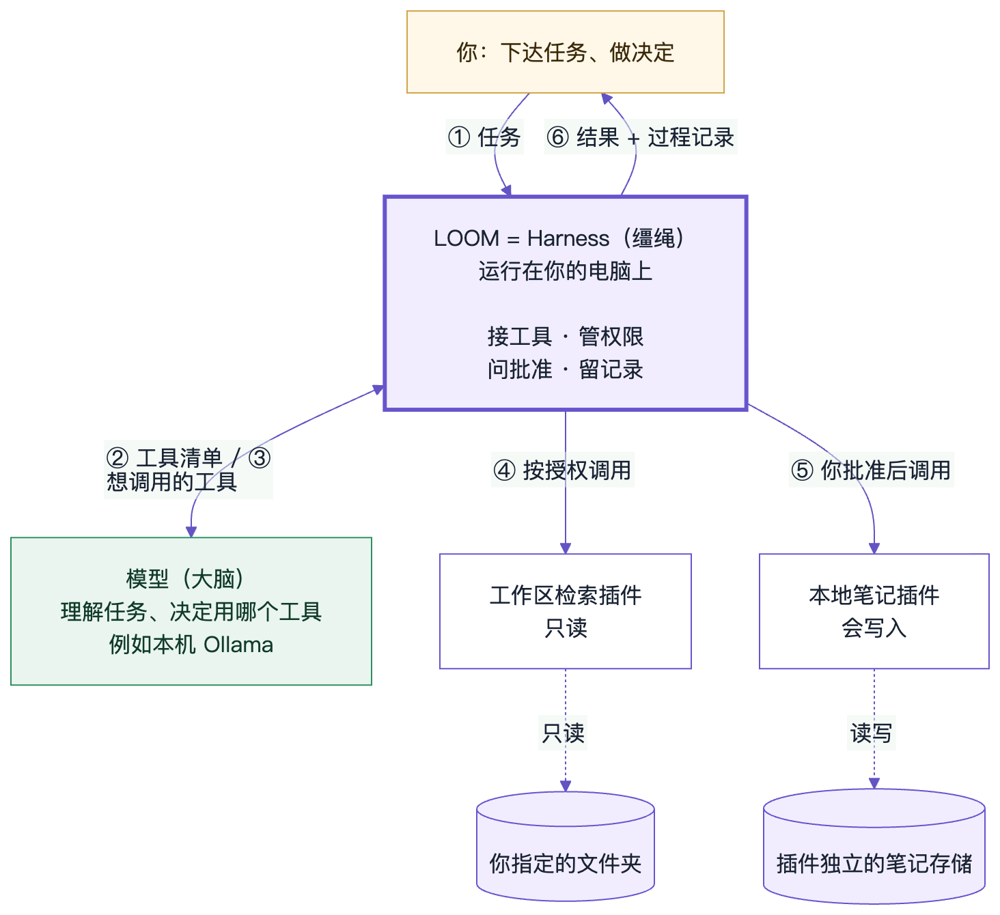

*图 1　一次任务怎样流转。你把任务交给 LOOM（①）；LOOM 把可用工具告诉模型，模型决定要调用哪个（②③）；LOOM 按授权调用插件，写入前先问你（④⑤）；最后把结果和完整过程交还给你（⑥）。模型自己从不直接碰你的文件。*

LOOM 管的四件事：

| 职责 | 具体含义 |
| --- | --- |
| **接工具** | 插件装上并启用后，它的能力自动变成 AI 可以调用的工具 |
| **管权限** | 每个插件只能访问你授权的资源，例如某一个文件夹、它自己的存储空间 |
| **问批准** | AI 想调用会改动数据的工具时，必须暂停，等你批准这一次 |
| **留记录** | 每一步调用了什么、结果是什么都显示出来，随时可以取消 |

---

## 2. 为什么要自己做，而不是直接用现成的 Agent？

现成的 Agent 产品很强，对多数日常需求，它们是更好的选择。LOOM 不和它们比谁更聪明，它关心的是另一件事：**这层 Harness 由谁掌握。**

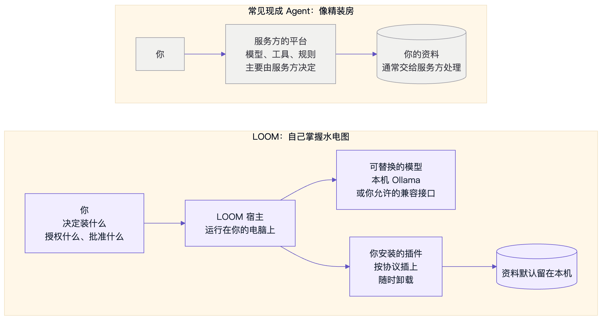

*图 2　现成 Agent 像精装房：拎包入住，但水电怎么走、哪扇门能开，主要由开发商决定。LOOM 像自己掌握水电图：装什么、授权什么、批准什么，都由你决定。*

| 你关心的问题 | 常见现成 Agent | LOOM 的做法 |
| --- | --- | --- |
| 数据去了哪里 | 通常需要把资料交给服务方处理 | 默认在本机运行、连接本机模型；只有你明确允许，才会连接远程模型 |
| 想加一个新能力 | 依赖官方提供，或在平台允许的范围内扩展 | 按协议写一个插件目录，安装就能用，宿主代码一行都不用改 |
| AI 能碰什么 | 由产品规则和你的设置共同决定 | 每个插件的权限都要你逐项授权；配置一改，授权自动作废 |
| AI 想改动数据 | 由各产品自己设计确认方式 | 只要 Agent 调用写入工具，宿主一律暂停，等你批准这一次 |
| 想换一个大脑 | 通常绑定平台提供的模型 | 本机 Ollama 或兼容 OpenAI 协议的接口都能接，插件和规则不用重做 |
| 想看清它做了什么 | 过程常常不透明 | 每次运行都显示步骤、工具调用和结果 |

**适合谁：** 想把 AI 接到自己的文件和工具上、又想自己定规矩的人；或者想真正弄懂 AI Agent 是怎么被“管”起来的人。**不适合谁：** 只想要一个开箱即用的聪明助手，那用现成产品更好。

---

## 3. 两个插件：证明能力是“插”上去的

LOOM 自带两个用途完全不同的示例插件。宿主里**没有任何专门为它们写的代码**，只认插件清单。

| | 工作区检索 | 本地笔记 |
| --- | --- | --- |
| 能做什么 | 列出文件、读取文本、按关键词搜索并返回文件路径和行号 | 新增、搜索、列出笔记 |
| 工具 | `list` · `read` · `search` | `add` · `search` · `list` |
| 需要的权限 | `workspace.read`（只能读你指定的那个文件夹） | `storage.read`、`storage.write`（只能用自己独立的存储） |
| 会不会改数据 | **不会**，全部只读 | **会**，`add` 是写入工具 |

自动化测试里还会现场生成第三个插件，不改宿主一行代码就能安装和运行。这证明扩展靠的是协议，而不是事先写死的功能。

---

## 4. 图文操作示例：从安装插件到让 AI 写笔记

下面的截图都是在一套独立的演示数据里实际操作拍下的，不是设计稿。

### 4.1 插件的一生：6 个关卡


*图 3　插件从安装到卸载要经过 6 个关卡。注意：只要修改了配置（第 ③ 步），之前的授权就会自动作废，需要重新授权启用。*

### 4.2 第一步：预检，先看清楚再决定

在“插件管理”里选择一个插件目录，宿主会**只读检查**它的清单，并计算代码指纹（SHA-256）。这一步**不会运行任何插件代码**。

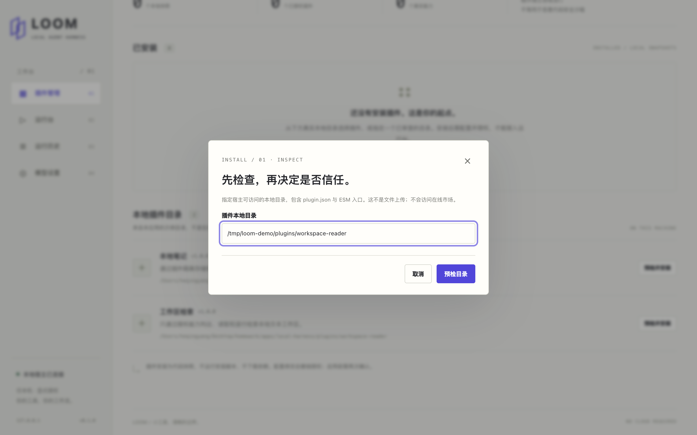

### 4.3 第二步：确认信任，安装代码快照

预检结果会列出插件名称、版本、作者、文件数、代码指纹和声明的权限。你必须勾选“我已审查并信任这份插件代码”，才能安装。宿主随后保存一份代码快照；如果代码在预检之后被改过，安装会被拒绝。

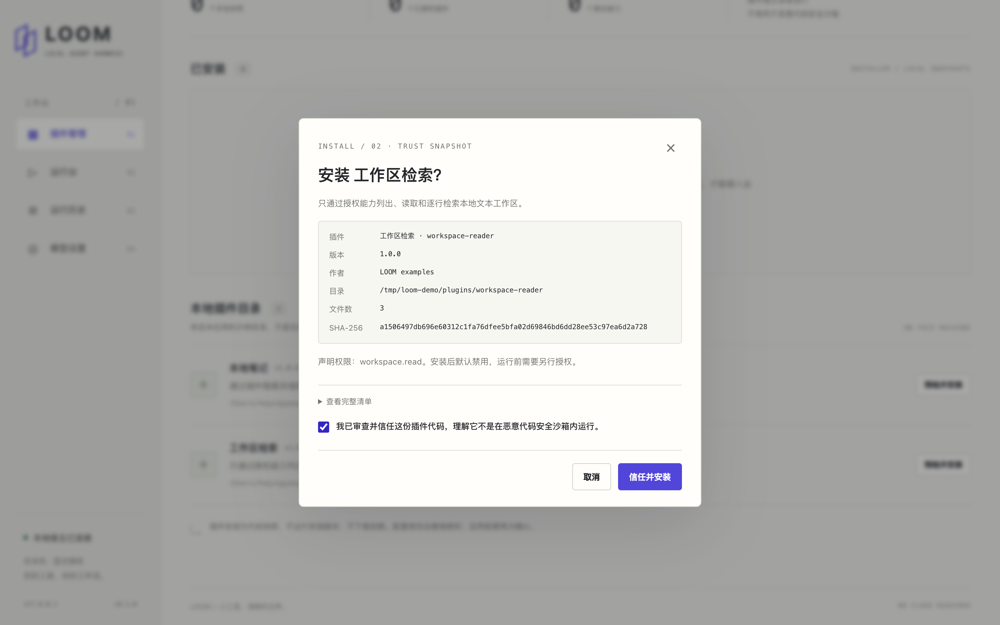

### 4.4 第三步：授权启用

插件安装后**默认是禁用的**。你要明确同意它声明的全部权限，它的工具才会出现在可用列表里。

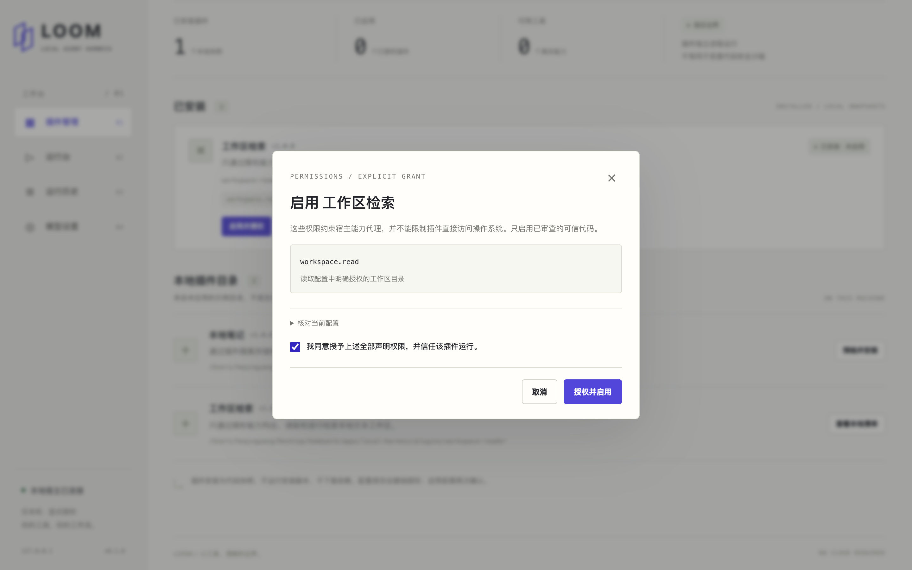

两个插件都启用后，插件管理页会显示它们的状态、权限和工具：

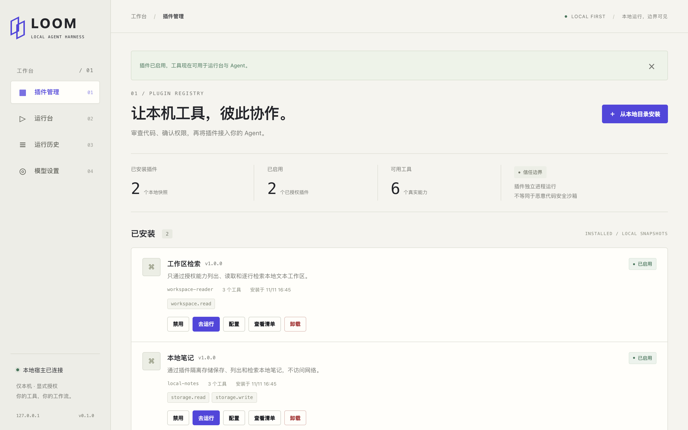

### 4.5 第四步：运行只读工具

到“运行台”选择 `workspace-reader__search`，输入关键词 `plugin`，就能看到命中的文件路径和行号。右侧的“执行详情”会逐步显示：开始、在独立进程中运行、通过能力代理读取文件、完成。

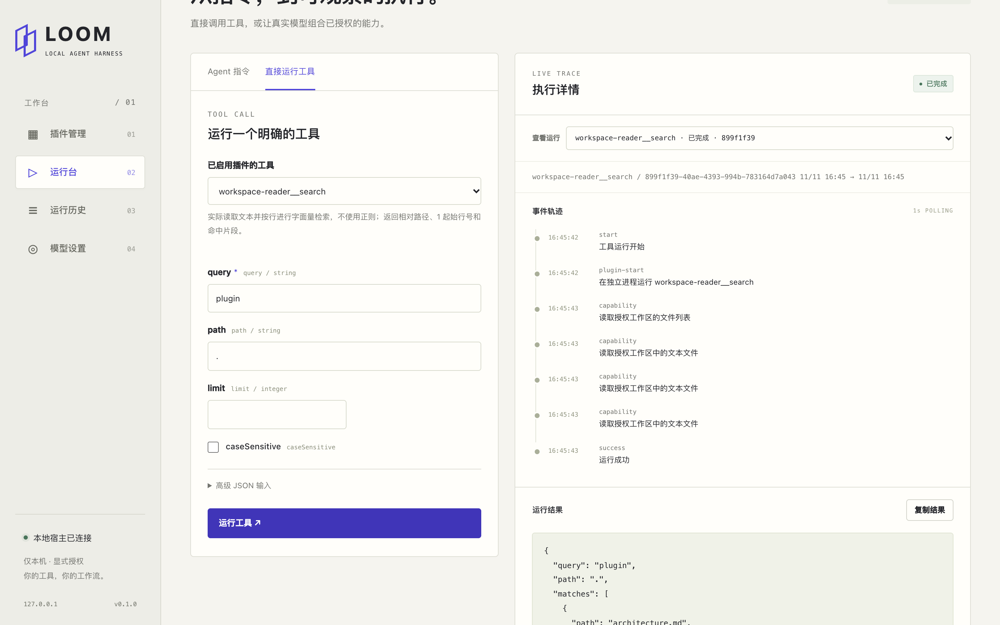

### 4.6 第五步：写入工具必须确认

选择 `local-notes__add` 写一条笔记。因为这个工具会改动数据，页面会先弹窗请你确认。

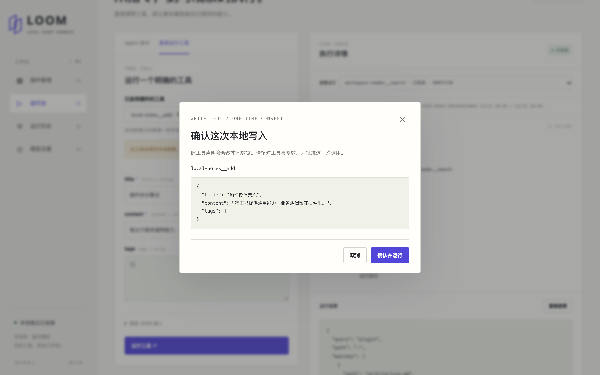

确认后笔记真正保存到插件的独立存储里，执行详情中可以看到“写入插件独立的本地存储”这一步：

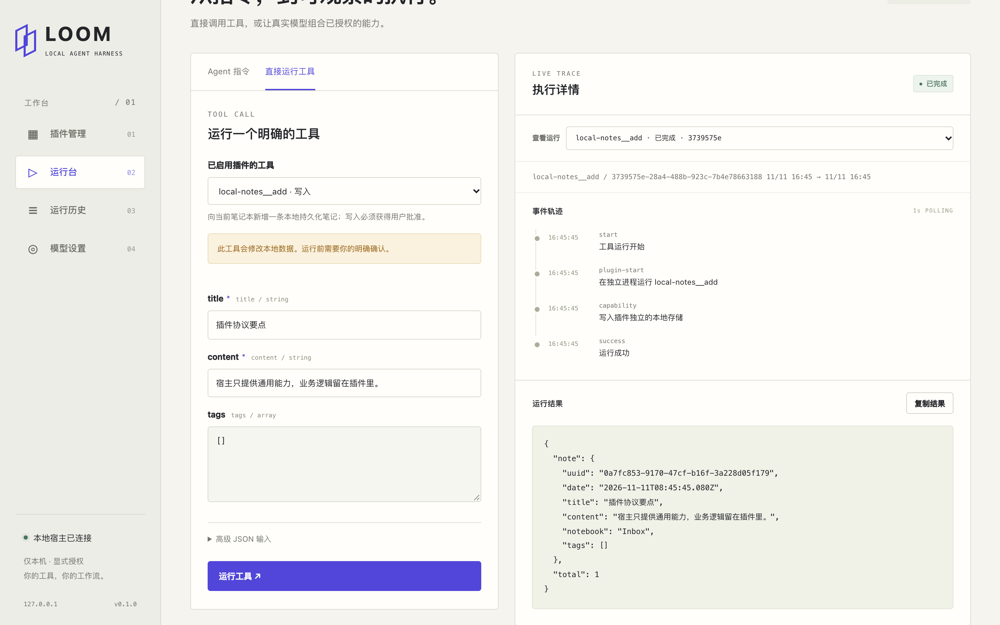

### 4.7 第六步：查看运行历史

每次运行的摘要都会留在“运行历史”里，方便回看。为保护隐私，历史只保存摘要；提示词和详细结果只保存在内存里，不写入磁盘。

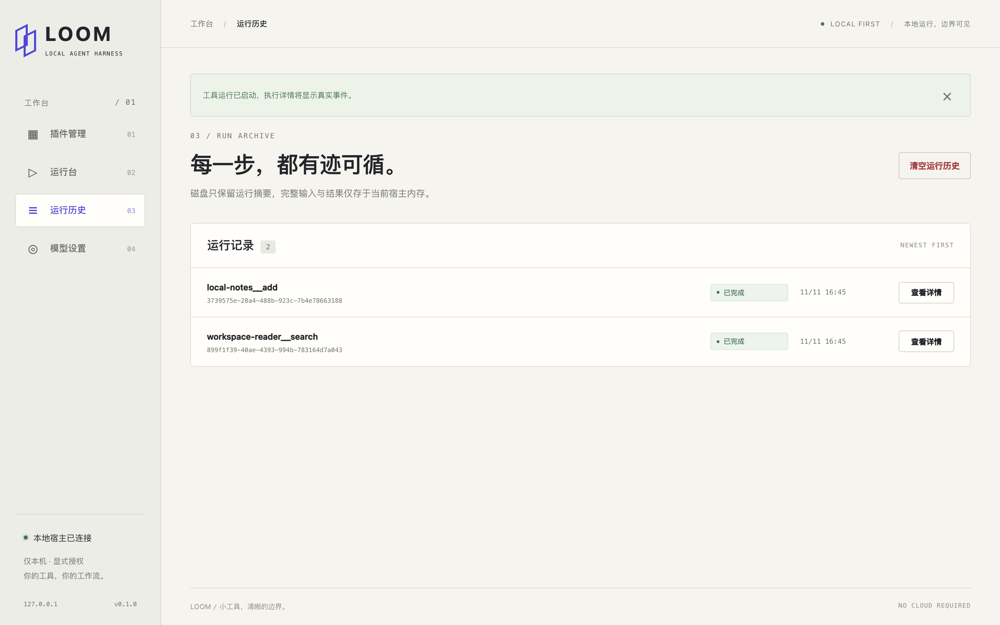

### 4.8 交给 AI：一次 Agent 任务的完整过程

上面是你手动运行工具。接入支持工具调用（tool calling）的模型后，你可以直接用一句话下达任务，让 AI 自己组合工具：

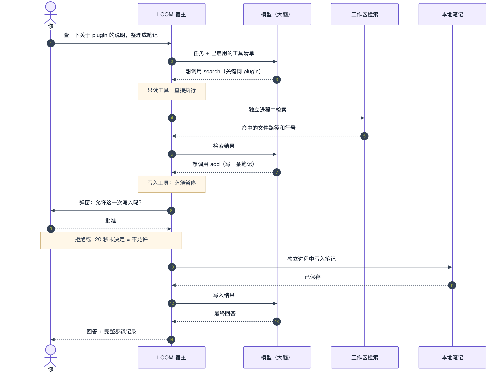

*图 4　“查一下关于 plugin 的说明，整理成笔记”。模型先调用只读的 search，宿主直接执行（③～⑤）；模型再想调用 add 写入笔记时，宿主强制暂停，弹窗问你（⑦～⑨）。你拒绝，或者 120 秒内没有决定，这次写入就不会发生。*

此外，Agent 的轮次、调用次数和总时长都有上限，不会无限循环；模型不可用时会直接报错，不会编造一个“成功”。

---

## 5. 安全与隐私：哪些能做到，哪些做不到

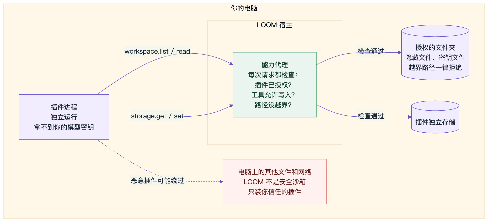

*图 5　插件每次访问文件或存储，都要经过宿主的“能力代理”检查。但插件本质上是一段在你电脑上运行的代码，恶意插件可以绕过宿主自行访问（红色虚线）。所以 LOOM 不是安全沙箱。*

**能做到**

- 网页控制台只监听本机地址（127.0.0.1），并校验请求来源和会话令牌，防止别的网页偷偷调用；
- 插件运行在独立进程中，不继承你的环境变量，拿不到模型密钥；
- 读文件只限授权文件夹，隐藏文件、密钥文件、依赖目录和越界路径一律拒绝；
- 只读工具即使所属插件有写入权限，也不能写入存储；
- 模型密钥只从环境变量读取，不显示在网页上，也不传给插件；
- 运行历史只保存摘要。

**做不到**

- **不是安全沙箱**：只安装你审查过、信任的插件；
- 数据以明文保存在本机，没有加密；卸载笔记插件会连同笔记一起删除，请先备份；
- 取消一个正在写入的任务，不会回滚已经完成的写入；
- 一旦你开启远程模型，提示词、工具定义和工具结果就可能离开本机。

---

## 6. 给插件开发者：插件长什么样

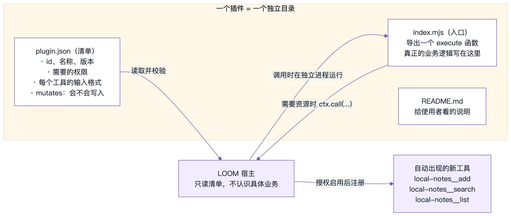

*图 6　一个插件就是一个独立目录。宿主读取清单，授权启用后注册工具；调用时在独立进程里运行入口函数；入口函数需要资源时，通过 `ctx.call(...)` 向宿主申请。*

以“本地笔记”的真实清单为例（节选）：

```json
{
  "protocolVersion": 1,
  "id": "local-notes",
  "name": "本地笔记",
  "entry": "index.mjs",
  "permissions": ["storage.read", "storage.write"],
  "tools": [
    {
      "name": "add",
      "description": "向当前笔记本新增一条本地持久化笔记；写入必须获得用户批准。",
      "mutates": true,
      "inputSchema": {
        "type": "object",
        "properties": {
          "title": { "type": "string", "minLength": 1, "maxLength": 160 },
          "content": { "type": "string", "minLength": 1, "maxLength": 8000 }
        },
        "required": ["title", "content"]
      }
    }
  ]
}
```

清单里的几个关键字段：

- `permissions`：插件需要的权限，用户必须逐项授权；
- `mutates: true`：声明这个工具会改动数据。宿主据此决定 Agent 调用时是否必须弹窗确认；
- `inputSchema`：工具参数的格式。宿主会先按它校验参数，网页控制台也据此自动生成输入表单。

入口文件导出一个 `execute` 函数，需要资源时向宿主申请：

```js
export default async function execute({ tool, args, config }, ctx) {
  const saved = await ctx.call('storage.get', { key: 'notes' }); // 读取自己的存储
  // ……业务逻辑……
  await ctx.call('storage.set', { key: 'notes', value: updated }); // 写入，需有 storage.write 权限
  return { ok: true };
}
```

*（上面的 `execute` 是简化示意；完整实现见 `plugins/local-notes/index.mjs`。）*

宿主目前只开放四种通用能力：`workspace.list`、`workspace.read`、`storage.get`、`storage.set`，业务逻辑全部留在插件里。完整协议见 [插件协议](docs/PLUGIN_PROTOCOL.md)。

---

## 7. 五分钟上手

需要 Node.js 20.19 或以上版本。

```sh
git clone https://github.com/heohme/homework-3harness.git
cd homework-3harness
npm ci --ignore-scripts
npm start
```

打开 `http://127.0.0.1:4317`，按第 4 节的步骤操作即可。也可以全程用命令行：

```sh
npm run cli -- plugins install ./plugins/workspace-reader --trust
npm run cli -- plugins enable workspace-reader --grant all
npm run cli -- tools run workspace-reader__search --args '{"query":"plugin"}'
```

想让 Agent 自动办事，需要另外在本机安装 Ollama，并下载一个支持工具调用的模型，然后在“模型设置”里填写模型名称并测试连接。

---

## 8. 项目现状与诚实说明

- 这是一个学习与作业项目（版本 0.1.0），不是商业产品，功能远不如成熟的 Agent 产品；
- 已通过 24 项自动化测试，覆盖插件生命周期、权限边界、HTTP 防护、Agent 调用协议和取消收尾，另有浏览器界面回归测试；
- 模型调用链路是用本机模拟的模型接口验证的，**尚未在真实模型上验证回答质量**；
- 不支持在线插件市场、插件自动升级、多用户和公网部署。

**延伸阅读：** [详细架构设计](docs/ARCHITECTURE.md) · [核心时序图](docs/CORE_SEQUENCES.md) · [安全、隐私与信任边界](docs/SECURITY.md) · [完整使用说明](docs/USAGE.md)

---

**能力可插拔，行动有边界。**
