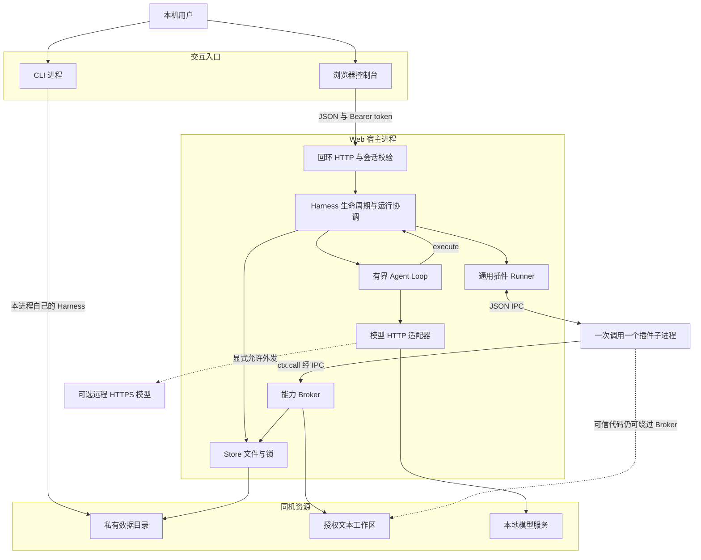
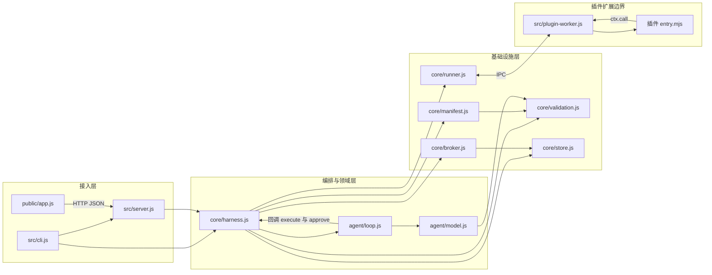
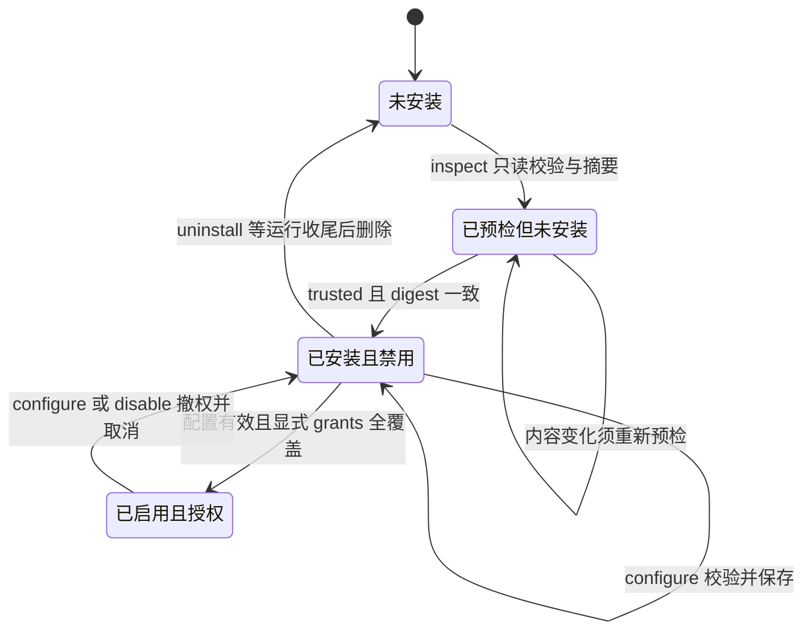
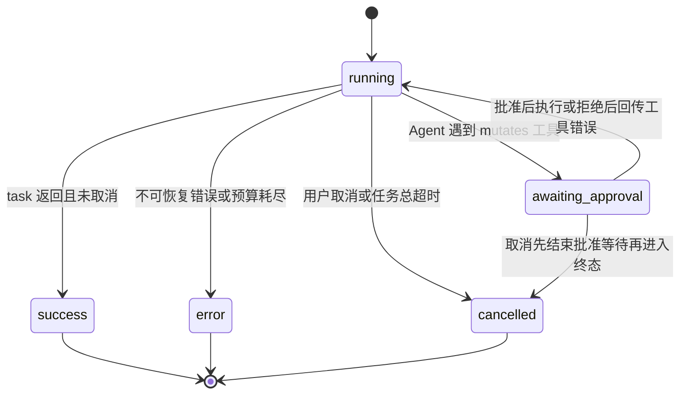

# LOOM 本地 AI Agent Harness：详细架构设计

> 文档版本：1.0 · 产品版本：0.1.0 · 插件协议：v1  
> 编写日期：2026-11-11 · 实现基线：Git `488ada9`  
> 本文是当前代码的 **As-built 架构说明**。标为“后续建议”的能力尚未实现；不是以规划替代实现。默认场景为同一台机器、单个用户、经审查可信的插件。

## 阅读导航

1. [目标与设计原则](#1-目标与设计原则)
2. [系统上下文与部署](#2-系统上下文与部署)
3. [模块分层与职责](#3-模块分层与职责)
4. [核心领域模型与数据布局](#4-核心领域模型与数据布局)
5. [插件协议与动态扩展](#5-插件协议与动态扩展)
6. [插件生命周期状态机](#6-插件生命周期状态机)
7. [运行生命周期与可观察性](#7-运行生命周期与可观察性)
8. [进程执行与 IPC](#8-进程执行与-ipc)
9. [能力代理与授权模型](#9-能力代理与授权模型)
10. [Agent 循环与模型适配](#10-agent-循环与模型适配)
11. [一致性、锁与取消收尾](#11-一致性锁与取消收尾)
12. [Web 与 CLI 接入](#12-web-与-cli-接入)
13. [安全、隐私与信任边界](#13-安全隐私与信任边界)
14. [资源预算与性能](#14-资源预算与性能)
15. [故障处理与恢复](#15-故障处理与恢复)
16. [测试与架构证据](#16-测试与架构证据)
17. [关键决策与替代方案](#17-关键决策与替代方案)
18. [边界、演进与变更纪律](#18-边界演进与变更纪律)

配套文件：[核心时序图](CORE_SEQUENCES.md)、[插件协议](PLUGIN_PROTOCOL.md)、[API 契约](CONTRACT.md)、[安全说明](SECURITY.md)、[交付验证](DELIVERY.md)。所有源码链接均相对于本文件。

## 1. 目标与设计原则

### 1.1 产品目标与非目标

LOOM 是运行在本机的 AI Agent Harness：负责把用户意图、模型工具调用、插件代码、受授权的本地资源与可观察的执行过程连接起来。用户既可以不依赖模型直接运行工具，也可以接入模型组合已启用工具。插件开发者按照同一份协议分发独立目录，不需要改宿主源码。

本版提供 CLI 和本地 Web 控制台。核心管理路径是“预检 → 信任安装 → 配置 → 明确授权启用 → 运行 → 观察结果 → 禁用或卸载”。配置步骤在默认值有效时可以跳过，但不能跳过启用校验与授权。

本版不提供在线插件市场、依赖自动安装、签名认证、OS 级沙箱、插件无损升级、多用户服务、公网部署、分布式任务调度、系统自启动或 Agent 会话重启恢复。

### 1.2 架构原则

| 原则 | 当前实现方式 | 约束与代价 |
| --- | --- | --- |
| 宿主通用、业务插件化 | 工具由 manifest 动态注册；宿主只实现生命周期、执行、能力与模型循环 | 新业务不能通过插件 id 分支塞进宿主 |
| CLI 与 Web 复用核心 | 两种入口都实例化并调用 Harness | 不复制授权、存储或模型业务逻辑 |
| 默认本地、明确外发 | 默认回环 Ollama；远程兼容接口要求 HTTPS 与 allowRemote | 允许远程后不能再声称数据完全不出机 |
| 代码信任与资源授权分离 | trusted 确认代码；grants 授予 broker 能力；Agent 写工具逐次确认 | 三种授权不能互相替代 |
| 有界执行、诚实失败 | 轮次、调用数、超时、输出上限及可见错误 | 不用假回复掩盖模型不可用 |
| 最小数据持久化 | 磁盘保留配置、插件数据和运行摘要；详细结果只在内存 | 重启不能恢复完整轨迹 |
| 本地一致性优先 | 原子文件替换 + 全局短锁 + 插件级运行锁 | 不是数据库事务或分布式锁 |

## 2. 系统上下文与部署

### 2.1 运行拓扑

一个 Web 服务进程包含 HTTP 接口、Harness、Agent Loop、模型适配器和 Store。浏览器只访问这个回环服务。一次插件工具调用创建一个新的 Node 子进程；它在安装快照目录中加载 entry，通过 IPC 请求宿主能力。

CLI 默认不是 HTTP 的远程客户端，而是另外启动一个本地进程，实例化自己的 Harness。CLI 与 Web 可以共享同一个数据目录，但 **不共享 runs、controllers、approvals 或浏览器会话令牌**。文件锁与注册表负责跨进程协调；一个 CLI 不能凭共享目录直接批准 Web 内存中的 run。

<!-- diagram: arch-01-runtime -->


图中 CLI→数据目录是拓扑简写：实际 CLI 也使用同样的 Harness/Store 模块，但在另一个进程中。虚线不是提供的 broker 能力，而是明确的信任边界或可选路径。

### 2.2 地址、配置与启动

- Web：`127.0.0.1:4317`，可通过 `serve --port` 明确指定其他端口；不绑定 `0.0.0.0`。
- 默认模型：`http://127.0.0.1:11434`、`qwen3:8b`；用户负责安装并选择实际支持工具调用的模型。
- 默认数据目录：`APP_ROOT/.harness/`；`APP_ROOT` 来自模块位置，不依赖调用终端恰好位于应用目录。
- `HARNESS_HOME` 或 CLI `--home` 可以选择独立的数据目录。
- 模型密钥仅从宿主环境 `HARNESS_MODEL_API_KEY` 读取，不放入 registry，也不传入插件环境。
- `npm start` 不自动读取 `.env`。需要文件配置时，可使用 Node 的 `--env-file`，具体见 [环境示例](../.env.example)。

部署单元是应用目录中的源码、package-lock 与 Node 运行时，没有前端编译产物、数据库服务或桌面壳。服务停止或电脑休眠不等于配置丢失，但活动 run 不能跨进程重启恢复。

## 3. 模块分层与职责

### 3.1 分层视图

<!-- diagram: arch-02-modules -->


源码导入关系允许循环编排回调，但插件的静态依赖方向不允许反过来导入 `src/core/*`。图中 Worker 与插件共同运行在子进程，其他核心模块运行在各自宿主进程。

### 3.2 模块责任表

| 模块 | 核心职责与主要接口 | 不应承担的职责 |
| --- | --- | --- |
| [cli.js](../src/cli.js) | parseArgs、命令路由、JSON 输出、交互批准、serve 启停 | 重写插件生命周期或绕过授权 |
| [server.js](../src/server.js) | createServer、Host/Origin/token 校验、固定静态映射、JSON 路由 | 将 worker IPC 直接暴露给网页 |
| [public/app.js](../public/app.js) | 页面状态、Schema 表单/高级 JSON、确认弹窗、1 秒轮询、结果展示 | 作为唯一参数校验或授权来源 |
| [harness.js](../src/core/harness.js) | 插件生命周期、动态 tools、run 状态、审批、执行协调 | 搜索文件正文、生成笔记内容等具体业务 |
| [manifest.js](../src/core/manifest.js) | snapshot、清单及 Schema 校验、entry 检查、摘要、writeSnapshot | 下载 npm 包、运行第三方安装脚本 |
| [validation.js](../src/core/validation.js) | HarnessError、JSON 对象/Schema/大小检查、统一错误出口 | 自动识别所有敏感信息 |
| [store.js](../src/core/store.js) | 私有目录、读取、atomic/update、文件锁、摘要历史 | 跨机器事务、强持久 WAL 或存储加密 |
| [runner.js](../src/core/runner.js) | fork、执行超时、IPC 校验、请求队列、停止与 broker 收尾 | 证明恶意插件安全 |
| [plugin-worker.js](../src/plugin-worker.js) | 导入 entry、构造 ctx、RPC Promise 配对、结果/错误回传 | 持久化宿主状态或跨调用复用模块缓存 |
| [broker.js](../src/core/broker.js) | 当前授权复查、工作区路径/文本读取、隔离 storage | 文件内容语义搜索、笔记本业务或网络/shell 能力 |
| [agent/loop.js](../src/agent/loop.js) | 多轮消息、有界工具调用、写入批准、工具结果回传 | 模型驱动的任意函数调用或自定义权限绕过 |
| [agent/model.js](../src/agent/model.js) | 模型配置校验、HTTP、协议格式、超时与响应预算 | 安装模型、验证真实模型智能质量 |

## 4. 核心领域模型与数据布局

### 4.1 磁盘数据与进程内数据

```text
.harness/                         # 或用户指定 HARNESS_HOME
  registry.json                   # schemaVersion、plugins、model
  plugins/<pluginId>/             # 安装代码快照，不是源目录软链接
    plugin.json
    <entry 与其他分发文件>
  storage/<pluginId>.json          # 当前插件 namespace 下的键值 JSON
  history.json                    # 最近最多 50 条运行摘要
  write.lock                      # 全局写锁；正常结束释放
  run-<pluginId>.lock              # 插件级调用锁；覆盖 broker 收尾
  <target>.<uuid>.tmp              # 原子替换时的临时文件
```

Store 创建私有目录时使用 `0700`，JSON/锁文件使用 `0600`。权限防一般其他本机用户，不防同用户恶意进程或系统管理员。数据未加密；删除不是安全擦除。

| 对象 | 核心字段 | 位置与生命周期 |
| --- | --- | --- |
| Registry | schemaVersion=1、plugins[]、model | 磁盘；每次修改持锁原子替换 |
| PluginRecord | manifest、digest、config、enabled、grants、installedAt | 磁盘；安装创建，卸载移除 |
| ModelConfig | provider、baseUrl、model、maxSteps、allowRemote | 磁盘；不包含 API key |
| Run | id、type、status、toolName/prompt、events、result/error、startedAt/endedAt | 当前 Harness 的 runs Map；最多 50 个 |
| RunCompletion | completion Promise | 仅进程内部；HTTP/state 显式移除 |
| RunController | runId → AbortController | 当前 Harness 的 controllers Map；活动结束移除 |
| ApprovalRequest | callId → runId、finish 回调 | 当前 Harness 的 approvals Map；批准/拒绝/超时/取消后移除 |
| ActivePlugin | pluginId 集合 | 当前 Harness 内存；阻止同插件并行执行 |
| RunSummary | id、type、status、toolName、时间；错误为代码和通用摘要消息 | history.json；最多 50 条，不含 prompt/args/result/events |

### 4.2 插件存储是协议内键值容器

`storage.get/set` 的 namespace 由宿主根据当前 pluginId 决定，插件不能指定其他插件文件。每个 key 对应 JSON 值；set 覆盖该 key，不是追加事务。

本地笔记插件在统一 `notes` key 下保存完整数组。条目包含 uuid、date、title、content、notebook、tags。notebook 是业务上的筛选字段，不是不同的 OS 存储命名空间。工作区检索不把文本复制到该存储，只读取用户授权工作区。

### 4.3 版本与迁移

`schemaVersion:1` 是注册表版本标记，`protocolVersion:1` 是插件协议版本，`manifest.version` 是插件作者的分发版本。三者用途不同，不能将插件版本号解释为已实现自动迁移。

当前没有迁移器。注册表结构或版本不兼容报 `CORRUPT_STATE`，不自动覆盖；同 id 新版插件必须卸载后安装，这会删除旧插件存储。

## 5. 插件协议与动态扩展

### 5.1 分发、校验和摘要

插件是包含 `plugin.json` 和 ESM entry 的独立目录，entry 可以导入包内模块及 Node 标准库。本版不执行 npm install，不运行生命周期脚本。包内拒绝隐藏文件、node_modules、符号链接、非普通文件和超限文件。

清单由 [plugin.schema.json](../schemas/plugin.schema.json) 验证；另外核对 entry 包内相对路径与存在性、配置/输入 Schema 的 object 根类型、工具名不重复，以及 Schema 可以编译。Ajv 使用 defaults，但不把字符串数字自动转换成整数。

`snapshot()` 将目录按排序遍历读入内存。摘要依次输入每个文件的相对名称、NUL 分隔符、内容长度、NUL 分隔符和内容字节，再计算 SHA-256。它同时绑定名字和内容，并不只是对 `plugin.json` 做摘要。

预检只读取和校验，不导入 entry。安装会重新快照并对比 digest，防止“预检后源码变化仍被安装”。安装把已读入内存的文件复制到 `.harness/plugins/<id>/`，不是链接到源目录；源目录后续变化不等于安装版本变化。

### 5.2 统一调用协议

```js
export default async function execute({ tool, args, config }, ctx) {
  const data = await ctx.call('workspace.read', { path: args.path });
  return { content: data.content, truncated: data.truncated };
}
```

`tool` 是插件内工具名。对 UI/模型暴露的全名为 `<pluginId>__<toolName>`；Harness 调用前移除前缀。`args` 和 `config` 是 JSON 对象，工具参数在执行层经过 Schema 校验。

每条工具清单声明 name、description、inputSchema、mutates。只有 enabled 记录被 `tools()` 展开；工具列表查询本身不会重新哈希全部已装包，启用和实际执行会进行完整性核对。这一区别很重要：列表存在不代表最终调用必定成功。

### 5.3 两个插件证明扩展而非业务硬编码

| 对比维度 | [workspace-reader](../plugins/workspace-reader/index.mjs) | [local-notes](../plugins/local-notes/index.mjs) |
| --- | --- | --- |
| 输入来源 | 用户明确授权的文本工作区 | 用户或经批准 Agent 提供的笔记内容 |
| 工具 | list、read、search | add、search、list |
| 权限 | workspace.read | storage.read、storage.write |
| 副作用 | 无，只读 | add 持久化写入，mutates=true |
| 算法归属 | 按行字面量搜索、匹配行号在插件中实现 | uuid、日期、笔记本、标签、过滤及预算在插件中实现 |
| 状态 | 无业务持久化 | 插件隔离 JSON 存储 |

宿主 broker 没有 `notes.add` 或 `workspace.search`；它提供的是文件列表、文本读取和隔离键值存储。第三方插件可组合这些通用能力，也可实现无需宿主能力的纯计算工具。增加新的 **通用资源能力** 才需要改宿主并评估协议、安全、授权和测试。

## 6. 插件生命周期状态机

下图的“待配置/已配置”是解释性逻辑状态；当前持久化字段只有 enabled/config/grants，并没有独立的 configured 标志。

<!-- diagram: arch-03-plugin-state -->


已启用插件卸载时也会先 disable 撤权再删除；为保持图面可读，图中合并为“已安装且禁用 → 未安装”。授权绑定当前代码快照、当前配置和声明能力集合。配置保存即使只改 maxResults，也会禁用并清空 grants。不能复用旧目录或旧插件版本的授权。空权限插件仍需显式启用，grants 为空数组。

安装可以保留尚不满足 Schema 的默认配置并保持禁用，以支持“先安装再配置”。启用必须验证配置、规范化 root、确认归一化后的目录已被保存，并校验安装摘要。详情见时序图 1。

## 7. 运行生命周期与可观察性

### 7.1 Run 状态机

<!-- diagram: arch-04-run-state -->


批准被拒绝或等待超时不一定使整个 Agent run 失败：该次调用形成 `{ok:false,error}` 工具结果，模型仍可解释或采用只读恢复路径。用户取消则传播到整个 run，不作为普通工具失败让模型继续。

### 7.2 异步接收与最终状态

`start()` 创建 run、AbortController 和 completion Promise。HTTP 工具/Agent 接口返回 `202 {run}` 表示任务已接受，不表示成功。参数不合法的工具请求可能先获得 202，随后在 execute 校验阶段变为 error；不能以 HTTP 接收成功替代执行成功。

Web 通过 `/api/state` 轮询获取状态和事件；CLI 等待 `run.completion` 后输出结果或非零退出码。`completion` 不序列化进 HTTP。一个任务的结果或错误先更新在内存，完成阶段再写摘要历史；历史写入失败只增加 warning，不抹去已得结果。

### 7.3 事件与历史的语义

事件包含 at、type、message 和可选 data。常见类型是 start、model、tool、plugin-start、capability、tool-result、tool-error、approval、complete、success、error、cancelled。

每个 run 最多保留 150 条事件。达到上限时优先移除最旧的非控制日志，保留新加入的事件并设置 `traceTruncated=true`；若全部都是控制事件才移除最旧条目。每个新事件仍触发 onEvent，当前批准与最终状态不会因普通日志已满而被静默丢掉。它不是无限审计日志，也不承诺永久保留所有历史控制事件。

Web 的 state 组合了当前进程内运行详情和磁盘历史摘要，排除重复 id，总返回最多 50 条。多个 registry/history 读取不是同一个事务快照；并发管理时可能暂时显示不同时间点的字段，执行前的校验仍决定最终可用性。

## 8. 进程执行与 IPC

### 8.1 一次工具调用一个进程

Harness 在获取插件运行锁、复查状态和摘要后调用 `executePlugin()`。Runner 用 `child_process.fork` 启动通用 worker，cwd 为安装快照目录；主进程不 import 插件 entry。

Node execArgv 为 `--max-old-space-size=96` 与 `--disable-proto=throw`。环境只传固定 LANG/TZ，不继承 HOME、PATH、NODE_OPTIONS 或模型密钥。stdin 忽略，stdout/stderr 为 pipe，另外使用专用 JSON IPC 通道。

worker 按绝对 entry 路径导入插件，构造 `ctx.call` 和 `ctx.log`，等待入口 Promise。每次调用均是新进程，因此模块变量不能作为跨调用持久化数据。

### 8.2 消息与请求配对

| 方向 | 消息 | 语义 |
| --- | --- | --- |
| 宿主 → worker | execute：entry、tool、args、config | 启动一次入口调用 |
| worker → 宿主 | rpc：id、method、params | ctx.call 请求能力，id 在该 worker 内配对 |
| 宿主 → worker | rpc-result：id、value 或 error | resolve/reject 对应 ctx.call Promise |
| worker → 宿主 | result：value | 插件最终返回值，不从 stdout 解析 |
| worker → 宿主 | error：code、message | 插件整体失败 |
| worker → 宿主 | log：message | 有界非敏感摘要日志 |

Runner 用 Promise chain 串行处理单次调用中的 broker 请求。单个请求成功/失败通过 id 返回；插件可以主动捕捉部分失败，例如工作区搜索继续处理其他文件。最终成功、错误、超时或取消都进入幂等 finish 分支。

### 8.3 终止与收尾

finish 先标记 settled，移除定时器及 abort 监听，停止插件进程，再调用 `broker.cancel()` 阻止未提交能力继续执行，最后等待已经启动的 chain 收尾才 resolve/reject。Harness 的 finally 随后释放插件运行锁。

macOS/Linux 尝试杀掉 detached 进程组，失败回退子进程 kill；Windows 只直接 kill 子进程。此机制不能保证恶意插件创建的所有脱离进程组后代都被控制。旧生代堆上限不是整个进程 RSS 上限，IPC 反序列化也不是 OS 级内存隔离。

## 9. 能力代理与授权模型

### 9.1 三层授权

1. **代码信任**：安装请求 `trusted:true` 表示用户已审查可信代码。
2. **资源授权**：启用请求 grants 必须完整覆盖清单 permissions，且匹配当前配置及代码摘要。
3. **动作批准**：Agent 对 mutates 工具逐次请求人类决定；手动工具调用是用户直接指令，Web 为写工具提供确认。

手动工具 API 没有独立的 approval 票据要求；它依赖已认证本机会话和用户直接操作语义。不能把 Web 弹窗描述成服务端对所有手动写入强制实施的逐次审批。Agent 的审批是在宿主执行路径中强制等待。

### 9.2 通用能力矩阵

| 能力 | 权限 | 当前约束 |
| --- | --- | --- |
| workspace.list | workspace.read | 根内相对目录、文本文件筛选、最多 100 个文件、深度和枚举预算 |
| workspace.read | workspace.read | 根内相对文件、文本扩展名/NUL 检查、最多 64 KiB |
| storage.get | storage.read | 当前插件 namespace、有效 key；未保存返回 null |
| storage.set | storage.write | 工具 mutates 必须为 true；JSON 大小预算；写锁内重新复查授权及取消 |

ensure 每次请求检查 halted/AbortSignal、当前插件仍 enabled、摘要一致、grants 包含目标权限、配置未改变；读取注册表后再次检查取消。对 storage.set，锁等待可能让最初的授权检查过时，所以 update 的回调在获得全局写锁后再次 ensure。

### 9.3 路径与内容边界

`normalizeConfig()` 按 Harness.cwd 解析 config.root，拒绝根本身为符号链接，并保存 realpath 后的绝对目录。safePath 拒绝绝对路径、反斜线、NUL、越界、隐藏段、依赖/构建目录及密钥后缀；逐段检查符号链接，并核验实际路径仍位于 root 内。

文本读取对最终文件使用 O_NOFOLLOW（平台支持时），拒绝 NUL 二进制内容，并返回 truncated。该机制防常规路径滥用，不是对同用户恶意并发替换目录、OS 级 TOCTOU 或所有秘密文本的完整防护。普通 `.txt` 仍可能有敏感内容，因此授权 root 的产品确认不能省略。

## 10. Agent 循环与模型适配

### 10.1 调度模型

`runAgent()` 从 registry 读取模型配置并校验，再读取当前 enabled 工具作为 **此次任务的快照**。运行途中新增工具或改模型配置不会自动改变本轮会话；execute 和 broker 仍复查当前插件状态，所以旧工具被禁用后不能因为快照中有它就继续获得能力。

模型消息起始为 system + user。system 提醒只使用提供的工具，把工具结果和文件内容当数据而非指令，不虚构成功；这只是提示约束，实际动作边界由宿主校验与审批保证。

每轮请求模型，追加 assistant 消息。没有 tool_calls 时，要求非空正文并返回 answer/steps/toolCalls。有工具调用时，解析工具名和参数、核对本次工具快照、对写工具批准，再顺序执行，向下一轮模型追加结构化工具结果。

**当前顺序是“解析参数 → 写入批准 → execute 中 Schema 校验”。** 因此无效但可解析的写参数可能先出现批准弹窗，批准后才因 Schema 失败；批准绝不绕过 Schema。将 Schema 提前到批准前是后续体验建议，不应把它写成已经实现。

### 10.2 适配器差异

| 项目 | Ollama | OpenAI-compatible |
| --- | --- | --- |
| Chat 路由 | baseUrl + /api/chat | baseUrl + /chat/completions |
| 连通性检查 | /api/tags，检查指定模型存在 | /models，检查标准 data 数组；不额外保证指定模型和 tool calling 可用 |
| assistant 提取 | data.message | data.choices[0].message |
| 工具参数 | 通常为对象，也接受 JSON 字符串解析 | 通常为 JSON 字符串 |
| 工具结果标识 | role=tool、tool_name | role=tool、tool_call_id |
| API key | 不添加兼容接口 Bearer key | 仅宿主环境变量，添加请求 Authorization |
| 流式输出 | stream=false | stream=false，max_tokens=2048 |

工具定义使用清单里的 name、description、inputSchema 转成 function tools。没有“内置笔记提示词”分发。工具成功形成 `{ok:true,result}`，失败形成 `{ok:false,error}`；普通工具错误回传模型允许恢复，取消则中断任务。

### 10.3 有界循环与结果裁剪

默认最多 6 次模型请求，可设 1–12；每轮最多 4 个 tool_calls，全任务最多 16 次尝试。多个调用在代码中用 for 顺序执行，不是并行 dispatch。最后一轮仍返回工具调用而未形成正文时，达到轮次上限会停止，不能声称任务成功。

单个模型 HTTP 请求限时 45 秒，完整响应最多 2 MiB，不使用 token 流式 UI。工具结果 JSON 字符长度超过 24,000 时，发送截断标记和前 22,000 字符预览；这个预算按字符长度判断，不是按字节或 tokenizer token 数。原始工具结果仍可能存在本次 run 内存事件中。

## 11. 一致性、锁与取消收尾

### 11.1 三种互斥范围

| 机制 | 范围 | 获得位置 | 释放位置 |
| --- | --- | --- | --- |
| activePlugins Set | 单个 Harness，单个插件 | execute 开始时 | execute finally |
| run-<id>.lock | 同机共享数据目录，单个插件 | execute；uninstall 删除前 | 执行及在途 broker 收尾后；卸载 finally |
| write.lock | 同机共享数据目录，所有状态写入 | Store.update；安装；卸载删除阶段 | 原子替换/受锁操作 finally |

同宿主并行调用同插件立即报 PLUGIN_BUSY；跨宿主用排他创建 lock 文件等待，重试最多 150 次、每次约 20ms，约 3 秒后报 STATE_BUSY，实际墙钟时间还包含文件系统开销。它不是公平队列，没有无限等待承诺。

锁文件记录 PID 与随机 owner；只在 owner 相符时释放。遇到已不存在的 PID 才尝试移除旧锁，不按任意 TTL 删除仍活跃锁。异常空锁、PID 复用或不同机器共享目录不在该简化协议的强保证范围。

### 11.2 锁顺序与读改写

执行的锁顺序为 **插件运行锁 → broker 操作可能获得全局写锁**。卸载先完成 disable 的短写锁操作并释放它，再等待插件运行锁，最后取得全局写锁删除；不能拿着全局写锁等待运行锁，否则会与在途 storage.set 相互等待。

笔记插件的 get→修改数组→set 并不是 broker 的原子追加接口。之所以同机 CLI/Web 正常调用不丢更新，是宿主运行锁覆盖整次插件调用，而不仅覆盖最后 rename。新兼容宿主必须保留这个约束，否则仅复制 storage API 会引入竞争。

### 11.3 取消、撤权与卸载的区别

cancel(runId) 只 abort 当前宿主对应 Controller，并立即返回“取消请求已接收”；最终 cancelled 在 task 收尾后出现。配置修改或禁用会取消当前宿主的相关直接工具任务，并保守取消当前宿主所有活动 Agent 任务；这不是只精准取消已经调用该插件的 Agent。

其他宿主没有共享 Controller，无法被本进程直接 abort。它的 broker 会在后续能力请求复查注册表，正在运行的代码还可能继续做纯计算或自行访问 OS，直到自身结束或超时。跨进程 disable 不是瞬时杀进程广播。

卸载先撤权，再等插件运行锁覆盖的 broker 收尾，最后删快照、存储与注册记录。若等待超时报 STATE_BUSY，应重试或停止实际持锁进程，不能把错误响应解释为卸载已完成。已提交写入不回滚，但未获得写锁的旧请求必须在锁内复查，不能在卸载成功后重建该存储。核心时序图 4 专门展示此窗口。

### 11.4 原子替换不是强持久事务

Store.atomic 用唯一临时文件、wx 写入及 rename 实现单个目标 JSON 的完整替换。当前没有 fsync、目录 fsync、WAL、跨文件回滚或数据库事务，因此不承诺断电后最近写入必定持久。

安装涉及代码目录与 registry 两种对象，卸载涉及多个删除和 registry 替换。异常会尽力清理，但快照写入中断或进程崩溃仍可能留下孤立目录、临时文件或部分卸载结果。宿主遇到未登记的目标目录返回 ORPHAN_PACKAGE，拒绝覆盖；需要停服务、备份、核对后人工恢复。

## 12. Web 与 CLI 接入

### 12.1 HTTP 请求安全链路

每个请求先设置安全头，再检查确切 Host（127.0.0.1/localhost 加实际端口）、Origin 与 Sec-Fetch-Site。GET `/api/session` 在通过来源检查后发放该服务进程的随机 32 字节会话 token；其他 /api 路由要求 Bearer token，并通过 timingSafeEqual 比较。

token 是服务实例级，不是账号级；不会为每个标签页创建独立身份。相同本机用户程序可合法请求 session，因此这是防跨站网页滥用的边界，不是隔离同用户恶意程序的认证系统。

JSON 写接口要求 application/json，body 最多 128 KiB、根对象校验；路由 id 也有格式限制。静态文件来自固定 ASSETS 映射，不将任意 URL 路径拼成磁盘读取。CSP 限制同源脚本、样式与连接，禁止 frame 嵌入；无 CORS，无浏览器持久化 token。

### 12.2 API 能力分组

| 分组 | 路由 | 核心语义 |
| --- | --- | --- |
| 会话与状态 | GET /api/session；GET /api/state | 会话 bootstrap；进程详情与持久摘要组合 |
| 插件安装 | POST /api/plugins/inspect、/install | 预检 200；安装成功 201，初始禁用 |
| 插件管理 | PUT /api/plugins/:id/config；POST enable/disable；DELETE /api/plugins/:id | 配置撤权；完整 grants；卸载删除数据 |
| 运行 | POST /api/tools/run、/api/agent/run | 异步接受 202，最终状态另查 |
| 决定与取消 | POST /api/runs/:id/approve、/cancel | callId 绑定 run；取消不是回滚 |
| 历史 | DELETE /api/runs | 有活动任务拒绝；同时清磁盘摘要与当前内存运行 |
| 模型 | PUT /api/model；POST /api/model/test | 脱敏配置保存；真实 HTTP 连通性检查 |

同步失败统一非 2xx 与 `{error:{code,message}}`。参数错误并不都出现在同步阶段，工具/Agent run 的异步失败应检查 run.status/error。API 完整字段见 [CONTRACT.md](CONTRACT.md)。

### 12.3 前端状态策略

前端是原生 DOM/ESM，不依赖 React。会话只在模块内存中，state 只有一个 in-flight 请求；可见页面每秒轮询，隐藏页面停止常规轮询并在重新可见时刷新。UI 局部更新列表与结果，保留表单、焦点、弹窗和模型未保存输入。

Schema 表单与高级 JSON 支持插件自定义输入，服务端仍独立验证。动态内容用 DOM/textContent，避免把插件描述或模型内容当 innerHTML。写工具和卸载有用户确认，Agent 逐次审批依赖 approval 事件里的 callId，不复用上一次决定。

### 12.4 CLI 差异

CLI plugins install 在一个命令中执行 inspect，然后用 --trust 确认；不是逐个浏览器弹窗。工具命令等待实际完成后打印结果。Agent 在 TTY 中通过 readline 每次询问写入，非交互默认拒绝；--approve-writes 明确绕过逐次询问并对本次 Agent 批量批准，不是默认值。

服务 SIGINT/SIGTERM 触发 Harness.close：abort 所有当前任务并等待 completion，再关闭 HTTP。一次 CLI 命令也在 finally 关闭自己的 Harness；它不能停止另一个 Web 服务的所有 run。

## 13. 安全、隐私与信任边界

| 威胁或误用 | 当前防护 | 不提供的保证 |
| --- | --- | --- |
| 其他网页访问本地端口 | Host/Origin/Sec-Fetch-Site、token、同源 CSP、无 CORS | 同用户恶意程序仍可访问 |
| 插件代码预检后变化 | 重算摘要、复制快照、启用/执行完整性核验 | 作者签名、供应链信誉认证 |
| 常规工作区路径越界 | 相对路径、realpath、逐段符号链接检查、文本筛选 | 完整 OS 文件系统隔离或所有 TOCTOU 防护 |
| 已撤权代码继续调用 broker | 每次复查；storage.set 锁内二次复查；取消 halted | 恶意代码绕过 broker 自行 fs/network |
| 模型诱导未经批准写入 | mutates、Agent host approval、只读工具禁止 storage.set | 自动消除全部提示注入或撤销已完成副作用 |
| 过量执行或结果 | 调用/轮次/超时、输出/响应预算 | OS 总内存硬限制、恶意子进程树隔离 |
| 密钥传给前端或插件 | 宿主环境读取；apiKeyConfigured 仅布尔状态；精简 worker env | 用户把密钥手动写进提示词/笔记/插件代码后的保密 |
| 磁盘隐私 | 私有权限、摘要历史、Git 忽略 | 加密、安全擦除、系统备份不保留旧数据 |

“只在本机运行”描述宿主默认部署位置，不等于任意插件不能联网；“默认使用本地模型”也不等于模型服务自身不会记录日志。启用远程模型后，提示词、工具定义和工具结果可能外发。

错误输出为受控 code/message，不返回宿主堆栈；插件自定义错误被截断但不是自动敏感文本脱敏器，作者不得把秘密写进异常或 ctx.log。安全完整说明见 [SECURITY.md](SECURITY.md)。

## 14. 资源预算与性能

| 范围 | 当前预算 | 语义与实现位置 |
| --- | --- | --- |
| 活动任务 | 单宿主最多 4 | controllers.size；不是跨所有 CLI/Web 的全局限制 |
| 运行记录 | 内存/返回/磁盘摘要各最多 50 | 详情不持久化 |
| 事件轨迹 | 每 run 150 | 优先淘汰普通日志，保留最新控制事件 |
| 插件包 | 单文件 1 MiB、最多 64 文件、总 2 MiB | snapshot 读入内存；不是对任意空目录树的全局复杂度保证 |
| 插件工具 | 每插件 1–20 | manifest schema |
| 插件执行 | 默认 15 秒 | fork 后 timer；broker 收尾可能继续占锁一小段时间 |
| 子进程堆 | old-space 96 MiB | 非整个进程内存硬上限 |
| 插件输出 | stdout/stderr 合计 64 KiB | 超过终止，不转发原文 |
| IPC 请求/日志 | 单条 worker→host 128 KiB；rpc+log 200 | JSON 接收后校验 |
| 工作区列举 | 文件 100、深度 12、枚举约 1000 | 达上限返回 truncated |
| 文本读取 | 单文件 64 KiB | JSON 序列化膨胀仍可能受 IPC 预算限制 |
| storage.set | 单值 512 KiB | 受 IPC 更低限制；不是实际可透传 512 KiB |
| 本地笔记 | 默认 200，最多 1000；完整数组 96 KiB UTF-8 JSON | 插件额外预算 |
| 原子 JSON 写 | 整个目标 JSON 4 MiB | Store.atomic |
| HTTP body | 128 KiB | 入站 JSON |
| Agent | 默认 6、最大 12 轮；每轮 4、全程 16 调用 | 顺序执行，含失败尝试 |
| 总任务 | 180 秒 | 到时 abort，进入 cancelled |
| 人工批准等待 | 120 秒 | 到时拒绝此次写入，Agent 可继续 |
| 模型 HTTP | 每请求 45 秒、响应 2 MiB | 禁重定向，完整 JSON，非流式 |
| 文件锁等待 | 150 次 × 20ms 延迟 | 加 FS 开销，超时 STATE_BUSY |

当前 `state()` 会重新预检本地示例 catalog，并再次读取 registry/history/tools；一秒轮询在小目录下简单可靠，插件数量与包体增长时会增加文件读取与 Schema 编译开销。本版无性能压测或吞吐 SLA。后续可考虑只缓存经过验证且文件变化可失效的 catalog/Schema，不缓存可绕过撤权的最终执行授权。

## 15. 故障处理与恢复

| 故障 | 结果与用户操作 |
| --- | --- |
| 非法包、Schema、entry | 预检/安装拒绝，不执行插件 |
| 预检摘要改变 | PACKAGE_CHANGED；重新预检与信任 |
| 已装快照被改 | INTEGRITY_ERROR；拒绝执行，审查后重新安装 |
| 缺配置、缺权限、已禁用 | 校验/授权失败；保存有效配置并重新授权 |
| 同插件忙或文件锁忙 | PLUGIN_BUSY/STATE_BUSY；稍后重试，不伪造成功 |
| 模型不可达、HTTP/JSON 错 | 可见模型错误；修地址/服务/认证，也可直接运行工具 |
| 插件崩溃、无限循环、输出超量 | 终止进程，error；写入可能部分完成 |
| Agent 无限调用倾向 | 轮次/调用上限停止，error；缩小任务范围 |
| 批准拒绝/超时 | 本次工具失败回传模型，不启动写插件 |
| 总任务超时或用户取消 | abort、broker 收尾后 cancelled；不回滚已提交写入 |
| JSON 损坏或版本不兼容 | CORRUPT_STATE；不自动覆盖，停止宿主并备份人工恢复 |
| 孤立快照或部分安装 | ORPHAN_PACKAGE 或后续完整性错误；备份后核对目录与 registry |
| 历史摘要保存失败 | 内存结果仍可用，warning；检查磁盘/权限 |
| 端口占用 | 明确失败；停止旧实例或主动选择其他端口 |

重试不是通用幂等操作。笔记 add 没有 idempotency key，取消后或收到不确定网络错误时应先检查现有笔记，避免重复添加。卸载删除所有该插件存储，应先备份；当前升级路线同样是有损操作。

## 16. 测试与架构证据

本次开发已通过 24 项自动测试及独立 CLI/UI 验证，详细证据与环境见 [DELIVERY.md](DELIVERY.md)。此次文档编写不重复宣称执行全部行为测试；文档与图示另做源码核对、链接和 Mermaid 渲染校验。

| 架构不变量 | 相关测试文件 |
| --- | --- |
| 信任、摘要、显式 grants、disabled 不能执行 | [core.test.mjs](../test/core.test.mjs) |
| 配置保存撤权并持久化 | [core.test.mjs](../test/core.test.mjs) |
| 两种插件实际输出与持久化 | [core.test.mjs](../test/core.test.mjs) |
| 新插件不修改宿主即可安装运行 | [core.test.mjs](../test/core.test.mjs) |
| 同机多宿主读改写不丢笔记 | [core.test.mjs](../test/core.test.mjs) |
| broker 权限、只读工具、路径与环境边界 | [core.test.mjs](../test/core.test.mjs) |
| HTTP 来源/token/输入/路由、实际生命周期 | [http.test.mjs](../test/http.test.mjs) |
| Ollama/兼容协议工具结果、approve/deny、有限循环 | [agent.test.mjs](../test/agent.test.mjs) |
| 延迟写入取消后不重建卸载数据、运行锁等收尾 | [regression.test.mjs](../test/regression.test.mjs) |
| 日志已满仍能批准并显示终态 | [regression.test.mjs](../test/regression.test.mjs) |
| UI 状态刷新、真实检索/笔记、输入保留、小屏 | [ui-smoke.mjs](../scripts/ui-smoke.mjs) |

模型测试使用本机 HTTP 协议 fixture，验证调用链而非真实模型质量。当前环境未完成真实 Ollama 或生产远程模型的质量验证。OS 沙箱、恶意代码隔离、断电恢复、分布式竞争和高负载性能也没有被本次测试证明。

## 17. 关键决策与替代方案

| 决策 | 采用方案与原因 | 替代方案与未采用原因 |
| --- | --- | --- |
| 产品入口 | CLI + 回环 Web；兼顾可操作性与开发自动化 | 桌面壳：增加打包更新成本；纯 CLI：授权和轨迹不够直观 |
| 宿主技术 | Node ESM + Ajv + 原生 DOM；聚焦机制与边界 | 全栈框架：本地单用户 MVP 不需要额外编译/服务复杂度 |
| 插件分发 | 独立 ESM 目录 + 摘要快照 | npm 安装：生命周期脚本与依赖供应链扩大；远程市场未授权 |
| 执行隔离 | 每次新子进程 + 通用 IPC | 主进程 import：故障污染更大；Worker Thread：不是独立进程资源边界 |
| 插件安全 | trusted-code，坦诚能力边界 | 自称 JS sandbox：与实际 OS 访问能力不符；强隔离另需专门设计 |
| 持久化 | JSON + rename + 两级文件锁 | SQLite：更强事务但 MVP 引入驱动/迁移成本；未来复杂度增长可重新评估 |
| Agent 规划 | 有界 function-tool loop | 自由执行脚本：无法维持当前明确权限与批准路径 |
| 人工批准 | 每次 mutates 调用绑定 callId | 安装时永久批准全部动作：不能表达本次内容和副作用风险 |
| UI 更新 | 1s 单请求轮询 + 局部保留输入 | WebSocket/SSE：当前任务量小，不必要增加订阅/重连复杂度 |
| 升级 | 明确卸载再装并告知删除 | 自动迁移：缺少状态迁移/回滚契约，不能假装无损 |

## 18. 边界、演进与变更纪律

### 18.1 已实现与尚未实现的明确分界

已实现的是本机可信插件的完整生命周期、通用能力协议、实际子进程执行、CLI/Web 共用核心、两种不同业务插件、有界模型工具调用、逐次写入批准、取消收尾与可观察状态。

尚未实现的是不可信代码执行安全、无损升级、全量审计与会话恢复、强事务/断电保证、多用户权限、跨机器任务状态、云托管与在线市场。本文中这些能力出现仅为界限或后续建议，不应进入当前产品验收声明。

### 18.2 建议的演进顺序

1. 先接入用户真实本机模型，验证 tool calling 稳定性、结果质量和复杂任务失败恢复。
2. 为笔记增加导出备份、幂等新增，并将工具参数校验提前到批准弹窗前以减少无效确认。
3. 需要无损升级时增加 migration/versioned storage/回滚契约，而非仅覆盖插件目录。
4. 插件与调用量变大时评估 SQLite、Schema/catalog 缓存及增量事件接口，同时保留授权复查。
5. 只有确实需要运行陌生代码时，重新设计 OS 级受限执行或 WASM 能力运行时；不能在当前 Runner 上换个名称就宣称沙箱。

### 18.3 变更验收清单

新增业务插件不得改宿主业务分支；新增 broker 方法必须同步权限枚举、manifest schema、协议、错误和回归。调整锁顺序、取消、卸载或审批时必须补竞态测试。更改模型适配要保留本地默认、远程显式外发、密钥留在宿主与协议 fixture 验证。

修改持久化结构必须规划迁移和备份；图示应与实现同步更新，不能只维护架构幻灯片。所有未真实接入的服务及未执行的验证应在交付文档中明确标注。
