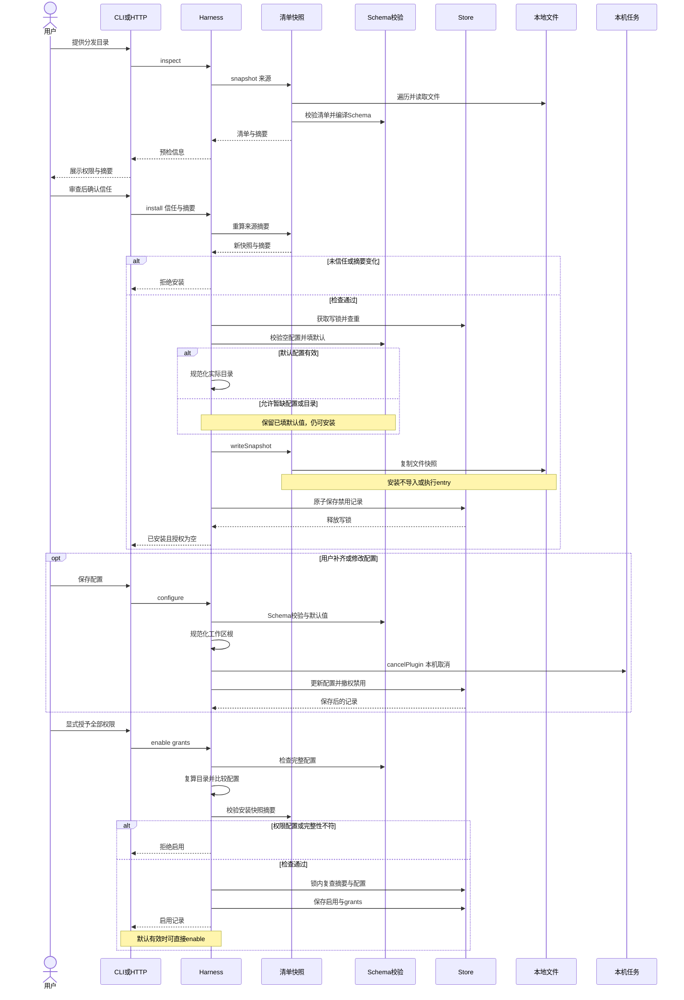
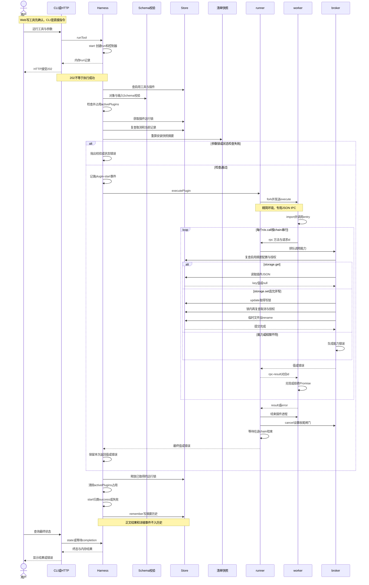
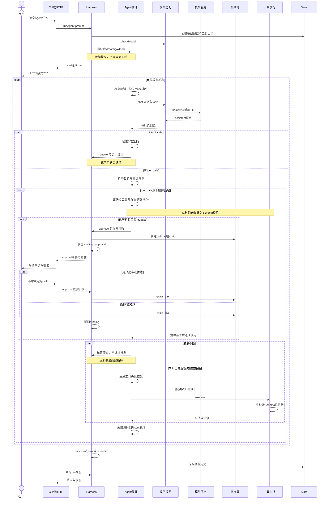

# LOOM 核心时序说明

> 代码基线：`488ada9`；应用版本：`0.1.0`。对象是纯本地 Node.js CLI + Web 插件宿主，不是托管服务。本文以当前源码为准，描述动作发生的先后、授权与锁的边界；整体模块与设计取舍见 [ARCHITECTURE.md](./ARCHITECTURE.md)（配套文档可能尚未生成）。插件开发协议见 [PLUGIN_PROTOCOL.md](./PLUGIN_PROTOCOL.md)。

## 目录

- [文档边界与图例](#文档边界与图例)
- [seq-01：插件预检、安装、配置与显式授权启用](#seq-01插件预检安装配置与显式授权启用)
- [seq-02：手动工具执行、IPC 与 broker](#seq-02手动工具执行ipc-与-broker)
- [seq-03：Agent 模型循环与逐次写批准](#seq-03agent-模型循环与逐次写批准)
- [seq-04：取消、禁用、卸载与延迟写入收尾](#seq-04取消禁用卸载与延迟写入收尾)
- [现有 24 项测试的主要相关证据](#现有-24-项测试的主要相关证据)

## 文档边界与图例

四张图编号为 `seq-01` 至 `seq-04`，每个 Mermaid 代码块前都有稳定的 `<!-- diagram: … -->` 标识。**Mermaid 源码可以直接编辑**；可按标识提取为独立 `.mmd` 再渲染 SVG。本文不另建图文件、不修改实现、不构建应用、不运行或重跑测试；末尾引用的是已有测试源码与交付记录，不代表此次新增实测。

图中实线箭头表示调用、请求或消息发送，虚线箭头表示返回、响应或通知；箭头不额外承诺操作已经持久化。`alt` 是互斥分支，`opt` 是可选操作，`loop` 是有界重复；`Note` 标注不能从普通成功路径推导出的边界。参与者是逻辑职责，未必各自对应进程：“CLI 或 HTTP”合并入口适配；Store 包含锁与本地 JSON 文件操作；worker 才是独立插件进程。异步 HTTP 回包与后台任务的微任务调度未逐条展开，图中的 `202` 不是执行屏障。

需要始终区分以下概念：

| 概念 | 当前含义 | 不代表什么 |
| --- | --- | --- |
| 安装信任 | `trusted:true` 且预检 digest 与安装重算一致 | 宿主证明代码安全、已执行入口或已授权运行 |
| 启用授权 | 当前代码记录、当前规范化配置、全部清单 permissions 的显式 grants | 此后每次写入都获得批准，或允许未来代码变化 |
| 本次写批准 | Agent 对 `mutates:true` 的一次调用取得批准 | 参数已通过 Schema、写入成功、可以回滚 |
| 运行锁 | 单宿主 `activePlugins` 加共享数据目录的 `run-<id>.lock` | 全局任务共享、跨机器锁、存储 CAS 或事务追加 |
| 原子文件替换 | `Store.atomic()` 写同目录临时文件再 `fs.rename()` 替换目标 | `fsync` 保证、跨文件事务、断电后必然恢复 |

运行、控制器和批准簿分别是某个 `Harness` 实例内的 `runs`、`controllers`、`approvals`；其他宿主只共享指定数据目录中的注册表、插件快照、存储、锁文件及摘要历史，不共享正在执行的任务控制权。`Store.atomic()` 没有调用 `fsync`，安装与卸载涉及多个文件/目录，也没有跨文件事务。受信任插件以本机用户权限执行，独立进程不是恶意代码沙箱；同用户恶意代码仍可直接访问文件系统或网络、篡改状态或绕过 broker。摘要与路径检查存在检查和使用之间的边界，不能宣称防止所有竞态。详见 [SECURITY.md](./SECURITY.md)。

## seq-01：插件预检、安装、配置与显式授权启用

### 参与者职责与前置条件

| 参与者 | 职责 |
| --- | --- |
| 用户 | 审查本地分发代码，确认信任、配置和权限范围 |
| CLI 或 HTTP | 将目录、预检摘要、配置和 grants 传给 Harness；HTTP 先做会话与请求校验 |
| Harness | 管理安装记录、配置撤权、启用前检查 |
| 清单快照 | `snapshot()` 遍历包、核验清单与 entry、重算文件摘要；`writeSnapshot()` 复制已读文件 |
| Schema 校验 | Ajv 编译和校验，应用 defaults，不做类型转换 |
| Store | 注册表读写与短期 `write.lock` |
| 本地文件 | 原始分发目录和安装快照目录 |
| 本机任务 | 当前 Harness 的活动控制器；不是其他宿主的控制器 |

前置条件是宿主已 `init()`，用户提供独立本地分发目录。包中包含 `plugin.json` 和清单指向的入口；预检读取文件和编译 Schema，但不 import entry。图把安装默认配置分为“有效”与“允许暂不完整”两条路径；两条路径都先落为禁用状态。

<!-- diagram: seq-01-plugin-lifecycle -->

### 关键顺序

1. `inspect()` 解析相对 `cwd` 的目录并调用 `snapshot()`。递归拒绝符号链接、隐藏文件、`node_modules` 和不支持的文件类型，限制单文件 1 MiB、64 个文件、合计 2 MiB；校验 manifest、包内 entry、工具名唯一性，编译配置与输入 Schema。摘要覆盖按遍历顺序读取的文件名、长度与内容，而不只是 `plugin.json`。
2. `install()` **先检查信任，再重新读取来源生成快照并比较 digest**，然后才获取 `write.lock`。锁内查重复 id 和未登记目录；安装复制的是这次读取到的字节快照，不创建源目录链接，也不执行 npm 安装或 entry。
3. 从 `{}` 应用默认配置并尝试规范化；仅容忍 `VALIDATION_ERROR`、`WORKSPACE_NOT_FOUND`、`WORKSPACE_REQUIRED`、`SYMLINK_DENIED` 这些默认配置问题。其他错误仍中止。记录始终是 `enabled:false`、`grants:[]`。**不是所有首次安装都必须先 configure**：默认配置已经完整且规范化结果已保存时，可直接显式 `enable`；缺少必填字段或实际目录不满足要求时才需先保存有效配置。
4. `configure()` 先校验克隆的输入并规范化 `root`，有效后才取消本机相关任务，随后通过 `Store.update()` 锁内检查当前 digest，保存配置并禁用、清空 grants。即使提交值与旧值相同，调用成功也会撤权；非法配置不会进入这一步。对于 `workspace.read`，相对 root 按 Harness 的 `cwd` 解析，并用真实目录路径保存，不按 worker cwd 解析。
5. `enable()` 要求 grants 数组恰好覆盖全部清单权限且无重复；空权限插件也必须显式传 `[]`。随后验证配置、重新规范化且要求与保存值一致，再重算安装目录摘要。最后注册表写锁内复查 digest 和配置未变，才写入启用与授权。`tools()` 此刻可枚举启用记录；但它本身只按 `enabled` 过滤，不是再次做全部授权或完整性核验，执行路径仍有额外检查。

### 失败分支与源码定位

| 失败位置 | 实际行为 |
| --- | --- |
| 不信任、安装摘要不匹配 | `TRUST_REQUIRED` / `PACKAGE_CHANGED`；没有入口执行 |
| 包格式、entry、Schema 不合法 | 预检或安装重读时失败，不生成可用工具 |
| 已安装 id 或孤儿目录 | `ALREADY_INSTALLED` / `ORPHAN_PACKAGE`，不覆盖现有目录 |
| 默认配置暂不完整 | 可安装但禁用；启用依然会严格拒绝无效配置 |
| configure 输入或目录无效 | 校验失败，不保存无效配置；尚未执行本次撤权 |
| 启用期间配置、版本或摘要变化 | `CONFIG_REQUIRED`、`PLUGIN_CHANGED`、`INTEGRITY_ERROR` 等；不能沿用旧确认 |
| 安装持久化失败 | 对已完整写好并标记 created 的快照做删除补偿；不是跨文件事务，异常或崩溃仍可能留下需检查的目录 |

源码：[harness.js](../src/core/harness.js) — `Harness.inspect()`、`install()`、`configure()`、`enable()`、`tools()`、`cancelPlugin()`；[manifest.js](../src/core/manifest.js) — `snapshot()`、`writeSnapshot()`；[validation.js](../src/core/validation.js) — `validate()`；[broker.js](../src/core/broker.js) — `normalizeConfig()`；[store.js](../src/core/store.js) — `lock()`、`update()`、`atomic()`；入口见 [server.js](../src/server.js) 的 `createServer()` 插件路由与 [cli.js](../src/cli.js) 的 `main()`。

## seq-02：手动工具执行、IPC 与 broker

### 参与者职责与前置条件

| 参与者 | 职责 |
| --- | --- |
| 用户、CLI 或 HTTP | 发起直接工具指令；Web 写工具先显示确认，CLI 等待最终 completion |
| Harness | 创建 run、输入校验、实例内排他、取得运行锁、核验当前状态与摘要 |
| Schema 校验、清单快照 | 验证 args 并应用 defaults；重算安装代码完整性 |
| Store | 插件运行锁、短写锁、插件 JSON 存储和摘要历史 |
| runner | fork、IPC 限额、单次 RPC chain、终止与等待收尾 |
| worker | 一次性 import entry，提供 `ctx.call()` / `ctx.log()`，发送最终结果 |
| broker | 每次能力请求复查授权与取消，执行受限工作区或存储操作 |

前置条件是工具已出现在启用目录，用户在手动入口明确发起调用。**手动工具 API 不走 `waitApproval()`**：Web 的确认在控制台，CLI 的 `tools run` 是直接指令；服务器并没有为手动写工具另存一张逐次批准票据。下图示例是声明 `mutates:true` 的工具使用存储读改写；只读工具和工作区读取分支在图后说明。

<!-- diagram: seq-02-manual-tool-ipc-broker -->

### 关键顺序

1. `runTool()` 仅同步检查名称类型，然后 `start()` 创建 UUID run、AbortController、`running` 状态和 `start` 事件，并安排后台 task。HTTP `POST /api/tools/run` 返回 `202` 与去掉 `completion` 的 run 对象；不存在的工具、非法 args、锁冲突或插件错误仍可能随后成为该 run 的失败。CLI 不使用 202，直接 `await run.completion` 再依据终态打印结果或非零退出。
2. `execute()` 查当前启用工具和插件，先验证 args 是 JSON 对象，再对克隆值应用 inputSchema；之后检查实例内 `activePlugins` 并占位。取得共享数据目录的 `run-<pluginId>.lock` 后，检查 signal、重读当前记录，比较启用、digest 与配置，再重算安装目录的执行摘要。锁必须覆盖整个入口和 broker 收尾，不能只包住一次 `storage.set`。
3. runner 通过 `fork()` 启动 [src/plugin-worker.js](../src/plugin-worker.js)，cwd 是安装快照目录；环境只给固定 `LANG` / `TZ`，JSON 专用 IPC 与 stdout/stderr 分开。worker 仅接受一次 execute，动态 import entry，调用 default export，传入未带插件前缀的 tool、args、config 和冻结的 ctx 接口。这里冻结的是 ctx 对象，不是 OS 权限。
4. `ctx.call()` 用递增字符串 id 注册 pending Promise，发送 rpc。runner 把 rpc 加到单次调用的 Promise `chain`，不是并发调用 broker。broker `ensure()` 每次读注册表，复查 signal / halted、启用、安装记录 digest、当前 config 和请求权限。这里的 digest 比较是**注册表记录比较**，不在每个 RPC 中重哈希插件目录；磁盘代码完整性重哈希在启用和执行前。
5. `storage.get` 读该插件 namespace 中的 key。`storage.set` 还要求本次工具 `mutates:true`，验证 key、保留键和 JSON 大小，然后通过 `Store.update()` 取得全局 `write.lock`；**锁内回调再次 ensure** 才设置 key 并原子替换 JSON。get→set 没有 CAS，不是事务追加；读改写的串行保障来自插件运行锁及遵守协议的执行路径。`workspace.list/read` 则做根内路径、符号链接与文本过滤，并返回有界结果和 `truncated`，不写插件存储。
6. worker 的 rpc-result 兑现或拒绝对应 Promise；插件可以捕获能力错误，只有未捕获错误才通常变成最终 error。worker 发送 result 或 error 后退出；正常 nullish 返回值在 worker 中转为 `null`。runner `finish()` 先置 settled、清定时器、终止进程并 `broker.cancel()`，再等已进入 chain 的工作排空。尚未启动的排队 RPC 会被 settled / aborted 检查跳过；已开始的请求要完成其收尾，才 resolve/reject `executePlugin()`。
7. `execute()` 的 finally 释放运行锁并清实例内占用；`start()` 随后设置 success/error/cancelled、结束时间、清控制器，调用 `remember()` 存摘要。取消信号即使在工具返回后被发现，也会阻止标记 success。内存终态可能已可见而摘要写入尚未完成；`completion` 包含最终 history 尝试。历史写失败只追加 warning，本次内存结果仍可查看。

### 失败分支与限额

| 分支 | 实际后果 |
| --- | --- |
| 工具不可用、args 不符合 Schema | `TOOL_UNAVAILABLE` / `VALIDATION_ERROR`；不 fork |
| 同实例同插件占用 | `PLUGIN_BUSY`；实例内拒绝，而非排队 |
| 跨实例运行锁等不到 | `STATE_BUSY`；有界等待后失败，而非无限等待 |
| 等锁后取消、配置变化、代码篡改 | `CANCELLED` / `PLUGIN_CHANGED` / `INTEGRITY_ERROR`；不启动入口 |
| 未授权能力、只读工具写入 | `PERMISSION_DENIED` / `WRITE_NOT_ALLOWED`；rpc-result error 拒绝 ctx.call |
| worker 启动、异常退出、抛错 | `PLUGIN_START_FAILED` / `PLUGIN_CRASH` / 插件错误；run 不是成功 |
| 超时或输出/IPC/request 超限 | 终止进程，设置 broker 闸门，仍等待 chain；不提前释放运行锁 |

默认插件超时 15 秒，覆盖导入、入口与等待 broker 的执行期；Node 老生代堆 96 MiB 不是整个进程的 OS 内存硬上限。stdout/stderr 合计 64 KiB，worker→宿主单条 JSON 消息默认 128 KiB，rpc 与 log 合计最多 200 条；stdout/stderr 原文不转发或保存。Store 锁用 `wx` 文件排他，尝试 150 次、冲突后每次延迟 20ms，并有限清理已退出 PID 的锁；这不是严格总耗时保证或分布式锁。

源码：[harness.js](../src/core/harness.js) — `runTool()`、`start()`、`execute()`、`event()`、`state()`；[runner.js](../src/core/runner.js) — `executePlugin()` 内的 `finish()`、`stop()` 与 `chain`；[plugin-worker.js](../src/plugin-worker.js) — message handler、`ctx.call()`；[broker.js](../src/core/broker.js) — `createBroker()`、`ensure()`、`safePath()`；[store.js](../src/core/store.js) — `lock()`、`update()`、`atomic()`、`remember()`；[validation.js](../src/core/validation.js) — `object()`、`validate()`、`jsonSize()`。手动入口见 [server.js](../src/server.js) 的 `createServer()`、[cli.js](../src/cli.js) 的 `main()` 和 [public/app.js](../public/app.js) 的工具表单 submit handler、`confirmToolRun()`。

## seq-03：Agent 模型循环与逐次写批准

### 参与者职责与前置条件

| 参与者 | 职责 |
| --- | --- |
| 用户、CLI 或 HTTP | 提交 prompt；对本次写请求作批准、拒绝或取消 |
| Harness | 读取本次模型配置与工具目录、启动 run、关联批准与终态 |
| Agent 循环 | 保存 messages，解析模型参数，顺序执行 tool_calls，回填结果 |
| 模型适配、模型服务 | 组装 Ollama / OpenAI-compatible 请求，校验有限 HTTP 响应 |
| 批准簿 | 当前 Harness 内用 callId 关联 runId 和 finish 回调 |
| 工具执行 | `Harness.execute()` 以及 seq-02 的 runner/broker 路径 |
| Store | 提供注册表；保存最终摘要，不保存模型对话正文 |

前置条件是非空 prompt 长度不超过 12000 字符、模型配置通过 `checkModel()`。`runAgent()` 在开始前读取 `registry.model` 与 `tools()`，本次循环捕获这两份值：**“冻结本次 tools/config 快照”是逻辑含义，不是调用 `Object.freeze()`**，其中 config 指模型配置。后续 `setModel()` 或新启用插件不会自动替换正在运行循环的值。插件运行配置并非在此全程冻结；真正执行仍读当前注册表并走 seq-02 复查，broker 也会发现撤权或配置改变。

<!-- diagram: seq-03-agent-model-write-approval -->

### 关键顺序

1. 模型 config / tools 捕获后，`agentLoop()` 建立 system 与 user messages。system 要求只用提供的工具、把文件与工具结果视为不可信数据、不伪造成功动作；这是提示约束，不是模型行为安全证明。每轮先检查取消，再记录 model 事件，`chat()` 把工具映射为 function 定义及 inputSchema。
2. Ollama 使用 `/api/chat`、`stream:false`，消息取 `data.message`；兼容接口使用 `/chat/completions`，设 `max_tokens:2048`，消息取 `choices[0].message`。OpenAI-compatible 密钥只从宿主 `HARNESS_MODEL_API_KEY` 读取，不入插件环境。模型响应必须是 assistant 且消息 / tool_calls 格式符合约束；无 tool_calls 时还必须有可显示的非空 content，才返回 answer、steps 和 toolCalls 计数。
3. 有工具调用时先限制本轮和累计数量，然后用 `for … of` **逐个 await**。同一模型回复中的多个 tool_call 不并发执行；每个调用先查本次 tools 快照，再把字符串 arguments 解析为 JSON，或者使用对象参数。未知工具、JSON 解析失败不会进入批准与执行。此时并未做 args 对象或 inputSchema 校验，因此批准界面可能展示尚不合 Schema 的参数。
4. `mutates:false` 直接进入 execute；`mutates:true` 先 `await approve(name,args)`。默认由 `waitApproval()` 创建随机 callId、关联 runId、设置 awaiting_approval，并发送含名称与参数的 approval 事件。`approve(runId,callId,approved)` 要求 callId 存在、归属匹配且 approved 是布尔值。批准票据不等于模型协议中的 tool_call id，也不等于 run UUID。
5. **只有批准后进入 `Harness.execute()` 才做输入 Schema 校验**，然后继续 seq-02 的排他、摘要、fork 与 broker 路径。批准可以成立但随后校验或权限检查失败；不能把批准事件称为“已写入”。read 直接执行也同样不能跳过 Schema。默认 HTTP Agent 接口不允许提交 `approveWrites` 绕过逐次批准。
6. 拒绝与批准等待超时都返回 false，loop 转为 `{ok:false,error:{code:'APPROVAL_DENIED',…}}` 工具结果，回给模型后允许模型解释或恢复。**拒绝某次写不必然令整个 Agent run 失败**：模型最终正常回复时，run 可 success，而那次工具仍明确失败。取消则不同：批准等待的 abort 会结束请求并返回 false，catch 看到 aborted 后向外抛出，不把它伪装成普通拒绝再请求下一轮；取消若发生在已批准执行路径，execute / runner 的 signal 检查也阻止继续启动或终止在途进程。
7. 每次工具结果 JSON 回填 messages。Ollama 用 `tool_name`；兼容接口用模型 call.id，缺少时用 `call_<累计次数>` 作为 `tool_call_id`。超过 24000 字符的结果只向模型回填带 `truncated:true` 的预览（约 22000 字符），不意味着存储回滚或原始结果被完整传给模型。普通工具异常转工具失败；取消异常向外传播。图中的取消箭头代表立即退出，之后的回填与后续迭代只发生于未取消路径。

### 限制、状态与失败分支

| 项目 | 当前实现 |
| --- | --- |
| 模型轮次 | 默认 6，可配置 1–12；耗尽后 `AGENT_STEP_LIMIT` |
| 工具调用数 | 每轮最多 4，全任务最多 16；超出为 `AGENT_CALL_LIMIT`；失败调用也计数 |
| 总任务与并发 | `start()` 的 180 秒总计时；每个 Harness 最多 4 个活动控制器，不是跨宿主总并发限制 |
| 模型 HTTP | 45 秒请求 signal 超时，响应最大 2 MiB，拒绝重定向；取消与连接失败分别报告，不产生模拟成功 |
| 模型地址 | Ollama 仅回环；兼容接口远程需 `allowRemote:true` 且 HTTPS；禁止 URL 凭据、查询与片段 |
| 批准等待 | 最多 120 秒；finish 清 timer、abort listener 与批准簿条目，暂回 running；终态随后由 start 归类 |
| 过期或错归属批准 | `APPROVAL_NOT_FOUND`；不能用别的 run 的 callId 批准当前任务 |
| 模型失败 | `MODEL_UNAVAILABLE`、`MODEL_HTTP_ERROR`、`MODEL_FORMAT_ERROR`、`EMPTY_MODEL_REPLY` 等进入 run error |
| 事件轨迹 | 最多 150 条，优先淘汰非控制事件并设 traceTruncated；批准及终态有保留优先级，不承诺无限完整轨迹 |

本机其他宿主撤权后，当前工具快照可能仍列出旧名称，但 execute 会因实时工具目录 / 状态失败，或在途 broker 因当前授权失败；不能把“固定 tools 快照”理解成持有永不撤销的能力。`cancelPlugin()` 对当前 Harness 的所有活动 Agent 都 abort，而非精准仅取消已经使用该插件的 Agent；没有跨进程全局 Agent 调度。

源码：[harness.js](../src/core/harness.js) — `runAgent()`、`waitApproval()`、`approve()`、`start()`、`cancelPlugin()`、`event()`；[loop.js](../src/agent/loop.js) — `agentLoop()` 的参数解析、mutates 判断、顺序循环与 messages 回填；[model.js](../src/agent/model.js) — `checkModel()`、`request()`、`chat()`、`testModel()`。CLI 的 `main()` 在 TTY 逐次询问，非 TTY 默认拒绝；只有显式 `--approve-writes` 才使本次 Agent 的 approve 回调直接返回 true，见 [cli.js](../src/cli.js)。模型连接测试不证明模型具备可靠的工具调用能力。

## seq-04：取消、禁用、卸载与延迟写入收尾

### 参与者职责与前置条件

| 参与者 | 职责 |
| --- | --- |
| 用户、CLI 或 HTTP | 请求取消、禁用或卸载；根据实际响应判断完成与否 |
| 管理宿主 | 收到操作的 Harness；只控制本实例 controllers |
| 执行宿主 | 持有该插件运行锁的 Harness；可能就是管理宿主，也可能是另一个 CLI / Web 实例 |
| runner、broker | 终止 worker、设置 halted、等待在途 RPC；锁内复查延迟写 |
| Store 锁、本地文件 | `run-<id>.lock`、`write.lock`，以及安装目录、存储 JSON、注册表 |

前置条件是一个调用已经取得插件运行锁，并有 `storage.set` 在途，可能卡在写锁之前。两宿主若不同，必须共享同一个本机数据目录，文件锁才构成协作；不同 HARNESS_HOME 不共享这些状态。图中“写先提交”与“延迟待锁”分支刻意分开，避免把撤权描述成能回滚已经开始且完成的提交。

```mermaid
sequenceDiagram
    actor U as 用户
    participant E as CLI或HTTP
    participant H as 管理宿主
    participant O as 执行宿主
    participant R as runner
    participant B as broker
    participant S as Store锁
    participant F as 本地文件
    O->>S: 持有插件运行锁
    O->>R: 执行插件调用
    R->>B: 在途storage.set
    B->>S: 初次授权检查
    opt 用户请求取消run
        U->>E: cancel runId
        E->>H: cancel
        alt 属于同一Harness
            H->>R: controller.abort
            R->>B: finish设置halted
        else 属于其他宿主
            H-->>E: 无本机控制器
            Note over H,O: 不能远程abort该任务
        end
    end
    alt 未取消且写先取得写锁
        B->>S: 锁内复查仍有效
        B->>F: 原子替换存储JSON
        B-->>R: 写入完成
        Note over B,F: 后续取消不回滚此写
    else 写入仍延迟待锁
        Note over B,S: 保留在途工作，尚未提交
    end
    U->>E: 禁用或卸载插件
    E->>H: disable或uninstall
    H->>H: cancelPlugin 本机abort
    Note over H,O: 其他宿主只靠复查或超时收尾
    H->>S: write锁内撤权禁用
    S->>F: 保存enabled为false与空grants
    opt 延迟写此后取得写锁
        B->>S: update锁内再ensure
        S-->>B: 取消或授权已撤销
        B-->>R: 拒绝写，不重建存储
    end
    R->>R: 取消错误或超时结束
    R->>B: finish设置收尾闸门
    R->>R: 等待已启动chain排空
    R-->>O: 返回结果或失败
    O->>S: release插件运行锁
    opt 本次请求为卸载
        H->>S: 等待插件运行锁
        alt 在有界等待内取得
            H->>S: 再获取全局写锁
            H->>F: 删除代码快照与插件存储
            H->>S: 原子保存移除后的注册表
            H->>S: 释放写锁与运行锁
            H-->>E: ok true
            E-->>U: 卸载完成
        else 运行锁或写锁繁忙
            H-->>E: STATE_BUSY或实际错误
            E-->>U: 卸载未成功，需检查重试
            Note over H,F: 先前禁用可能已完成
        end
    end
    Note over R,F: kill不撤销已完成的磁盘提交
```

<!-- diagram: seq-04-cancel-disable-uninstall-drain -->

### 关键顺序

1. `cancel(runId)` 查**当前 Harness** 的 controller，存在则 abort，并立即返回 `{ok:true}`；这只是已发送取消信号，不是 `completion` 已结束，更不保证没有任何写入。没有活动 controller 时是 `RUN_NOT_ACTIVE`，不读取另一个实例的历史摘要去远程 kill。runner 的 abort listener 进入 finish，停进程并设置 broker.halted；模型请求也组合相同 signal。
2. `disable(id)` 先确认插件存在，调用 `cancelPlugin(id)`，再通过 `Store.update('registry.json')` 获取 `write.lock`，设置 `enabled:false`、`grants:[]`。本机对应手动任务和全部活动 Agent 被 abort；其他宿主不收此 abort，但后续 broker 复查注册表会失去能力。对正在纯计算、不再调用 broker 的其他进程，只能等待其正常返回或插件超时；它并非立刻远程终止。
3. `storage.set` 不能只依赖进入 broker 时的 ensure。若先前授权检查成功，但请求等待写锁期间发生取消、配置改变、禁用或卸载，`Store.update()` 锁内回调重新 ensure，看到 halted / signal 或注册表状态后拒绝，不把被删除数据重新写回。反过来，如果写已持有 `write.lock` 且复查通过，撤权的 update 只能等该锁；随后已提交的写不会被取消回滚。锁内检查并未让所有异步取消都变成事务回滚。
4. `executePlugin.finish()` 无论成功、错误、取消或超时，都先终止进程并 `broker.cancel()`，再等 chain 排空。被 kill 的 worker 不等于宿主内已开始的异步 fs 请求消失。只有 executePlugin 的 Promise 收尾后，`Harness.execute()` finally 才释放 `run-<id>.lock`；这是卸载不能先删除、随后让旧 broker 重建数据的关键次序。
5. `uninstall(id)` **先 await disable，再取得同一插件运行锁，再取得全局写锁**。成功取得两把锁后，删安装目录、删 `storage/<id>.json`，过滤注册记录并 atomic 保存；finally 释放写锁和运行锁。图中锁等待和执行收尾可以时间重叠，但卸载必须在执行方 release 之后才能真正拿到运行锁并开始删除。当前存储与快照删除不等于安全擦除，也没有无损升级或迁移。
6. 跨实例协作靠注册表和文件锁，不靠共享 run 对象。其他宿主最终可能是能力失败、超时、正常完成或收到它自己宿主的取消；管理宿主不能预先替它伪造某个终态。其他宿主计算已完成且无后续 broker 请求时，即使本插件已禁用，其已有调用仍可能返回成功；禁用是撤销后续能力和工具可见性，不是跨进程回溯失败协议。

### 失败、残留与恢复边界

| 场景 | 必须如何理解 |
| --- | --- |
| cancel 返回 ok | 信号已发出；还需等待当前 run 终态与 completion，不能声称回滚成功 |
| disable 返回成功 | 注册表撤权已保存；同宿主 abort 已触发，但所有进程收尾未必都结束 |
| 卸载运行锁超时 | `STATE_BUSY` 是卸载失败，HTTP 不是成功 200；已先禁用的状态可能仍保留 |
| 已拿运行锁但写锁失败 | finally 释放已得运行锁；依然不是卸载成功，需检查实际状态 |
| 删除或注册表写入失败 | 多文件操作可能部分完成；没有跨文件事务，不能只按“已请求卸载”推断最终磁盘状态 |
| 写已提交但最终结果丢失 | 取消不回滚；先 list / 检查真实数据再重试，避免重复新增；v1 没有幂等新增键 |
| 宿主异常退出 | 锁可有限检测已退出 PID，但不提供跨机器租约、完整崩溃恢复或原子升级 |

图中的锁内复查与等待机制是当前遵守协议的宿主路径的保护，不防同用户恶意插件直接写磁盘、替换锁文件或另起进程。不能以“独立进程”“文件摘要”“原子 rename”宣称沙箱、全局任务共享或消除所有 TOCTOU / 文件系统竞态。

源码：[harness.js](../src/core/harness.js) — `cancel()`、`cancelPlugin()`、`disable()`、`uninstall()`、`execute()` 的 finally、`start()`、`close()`；[broker.js](../src/core/broker.js) — `createBroker()` 的 `ensure()`、`storage.set` 更新回调、`broker.cancel`；[runner.js](../src/core/runner.js) — `finish()` 与 `chain`；[store.js](../src/core/store.js) — `lock()`、`update()`、`atomic()`；[server.js](../src/server.js) — `createServer()` 的 cancel / disable / DELETE 路由及错误响应。

## 现有 24 项测试的主要相关证据

[DELIVERY.md 的实际验证](./DELIVERY.md#实际验证) 记录当前自动套件共 **24 项**：core 12、agent 6、HTTP 3、regression 3。此次只阅读这些测试与实现，**未重跑测试**；以下是主要相关断言的来源，不是新增测试报告，也不将协议 fixture 称为真实模型质量验证。

| 对应图 | 文件与测试名称 / 关键断言 |
| --- | --- |
| seq-01 | [core.test.mjs](../test/core.test.mjs) — `installation requires trust, matching digest and explicit grants; disabled tools cannot run`：不信任与错 digest 被拒绝，安装后工具为空；默认工作区配置可直接 enable，无需先 configure |
| seq-01 | [core.test.mjs](../test/core.test.mjs) — `configuration is schema-validated, revokes grants and survives restart`：非法数量被拒绝，有效配置禁用且清 grants，重建 Harness 后配置仍在 |
| seq-01 | [core.test.mjs](../test/core.test.mjs) — `third-party plugins can install before supplying mandatory configuration`：缺必填默认值可安装为禁用，enable 失败，补配置后显式空权限启用成功 |
| seq-01、02 | [core.test.mjs](../test/core.test.mjs) — `a third plugin installs dynamically with no host changes, and package tampering is rejected` 与包格式测试：第三方可扩展，安装代码篡改导致 INTEGRITY_ERROR；协议、entry 与符号链接有拒绝断言 |
| seq-02、04 | [core.test.mjs](../test/core.test.mjs) — `notes are real persistent plugin storage; uninstall removes its data`、`multiple host instances serialize note read-modify-write without losing updates`：真实存储可重启读取，历史不含笔记正文，卸载删存储，两 Harness 共享目录的更新不丢失；这里的双实例测试不等于所有独立 OS 进程情形均已证明 |
| seq-02 | [core.test.mjs](../test/core.test.mjs) — 未声明 broker 权限、只读工具写入、broker 自身路径越界、进程超时/取消、宿主环境不继承的测试：验证协议能力拒绝与实际 worker 路径，不能据此证明恶意代码隔离 |
| seq-02 | [http.test.mjs](../test/http.test.mjs) — `API supports inspect/install/configure/enable/run/disable/uninstall without hard-coded dispatch`：运行先收到 202，再轮询 run.status 并检查真实结果；另两项覆盖会话、Host/Origin、非法 JSON、体积与模型 URL |
| seq-03 | [agent.test.mjs](../test/agent.test.mjs) — Ollama 动态工具读取、`Agent writes wait for user approval; approved notes persist`、`denied write returns failure to the model and never changes storage`：批准前无存储，批准后真实写；拒绝回填 APPROVAL_DENIED，最终 Agent 可正常回复 |
| seq-03 | [agent.test.mjs](../test/agent.test.mjs) — OpenAI-compatible `tool_call_id`、未知工具与轮次限制、模型不可用：验证请求路径、结果关联和可见失败，不伪造模型成功 |
| seq-04 | [regression.test.mjs](../test/regression.test.mjs) — `queued storage.set rechecks cancellation after obtaining its write lock and cannot recreate deleted data`：延迟写在锁内发现取消，卸载后不重建存储 |
| seq-04 | [regression.test.mjs](../test/regression.test.mjs) — `cancelled worker retains its plugin lock until in-flight broker drains, so uninstall cannot finish early`：取消后运行锁仍在，卸载等待在途 broker，排空后才成功删除 |
| seq-03 | [regression.test.mjs](../test/regression.test.mjs) — `150-entry trace limit never hides current approval or final state, and CLI receives the control event`：满日志轨迹仍可取当前 callId、批准与接收终态 |

这些证据覆盖代表性生命周期与竞态回归，不覆盖所有崩溃时刻、恶意同用户进程、不同文件系统语义或真实 LLM 的工具选择质量。源码是时序语义的最终依据；扩大保证范围前需要相应实现与新增实测证据。
