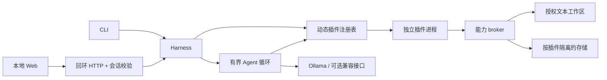

# 技术设计

## 运行环境与模块

Node.js 20.19+，JavaScript ESM，Ajv 8.17.1 校验 draft-07 JSON Schema。前端为静态 HTML/CSS/ESM，不需要打包。Playwright 只用于开发验证，使用已安装的 Chrome，不下载或安装全局浏览器。依赖与版本由应用内 package-lock.json 固定。

CLI 与 HTTP 都调用 `Harness`。宿主包含清单验证、安装快照、注册表、执行过程、权限 broker 和 Agent 调度；示例业务只存在于 `plugins/`。插件 entry 被子进程导入，不被主进程导入。宿主通过 IPC 接收能力请求与结果，插件使用稳定的 ctx 接口，不导入宿主内部文件。

## 状态与生命周期

数据默认位于本应用 `.harness/`，可用 HARNESS_HOME 或 CLI --home 修改。私有目录权限 0700，JSON 文件 0600。registry.json 记录已装清单、代码摘要、配置、权限、启用状态和非敏感模型设置；plugins/ 保存实际安装快照；storage/ 保存插件主动写入的数据；history.json 只保存运行摘要。

原子临时文件加 rename 防止半写入 JSON。短写锁序列化跨进程注册表更新；插件级运行锁覆盖一次完整的读改写，防止 CLI 和 Web 同时保存笔记时丢失更新。单宿主拒绝同插件并行执行；跨宿主等待短锁，繁忙时明确报错。不实现分布式锁或数据库。

安装默认禁用。完整权限授权后启用。配置修改自动禁用、清除授权，并取消当前宿主中的相关任务；其他宿主的 broker 在每次调用时重新核验注册表。安装快照摘要与执行前摘要不一致则拒绝运行。升级本次采用明确卸载再安装，会删除该插件数据，必须先备份。

## 执行与模型

子进程不继承宿主的 HOME、PATH、NODE_OPTIONS 或模型密钥，只传入固定 LANG 与 TZ，使用绝对 Node 路径启动。JS 堆上限 96 MiB，默认工具 15 秒超时，stdout/stderr 最大 64 KiB，IPC 数据及结果有上限，请求数量最多 200。取消终止插件进程组；这不是完整 OS 资源或恶意进程树隔离。

Agent 使用清单动态生成 function tools。Ollama 参数使用对象，OpenAI-compatible 参数兼容 JSON 字符串，并返回相应 tool_name / tool_call_id。默认最大 6 轮，可设 1–12；每轮最多 4 个调用，全任务最多 16 次，总运行最多 3 分钟。插件输入始终经过 schema 校验，不因模型生成而绕过校验。

写工具先暂停为 awaiting_approval，用户逐次批准后才能启动插件。等待最多 2 分钟；拒绝或超时返回失败给模型。只读工具不能通过 broker 调用 storage.set。CLI 非交互默认拒绝写请求；--approve-writes 是用户显式选择的批量批准，不是默认行为。

## 服务与配置

HTTP 只绑定 127.0.0.1，默认端口 4317。校验确切 Host 与 Origin，拒绝跨站，API 使用随机会话令牌。令牌只在页面内存中保留，不持久化到浏览器。静态文件只来自明确允许的固定映射，CSP 禁止外部脚本与嵌入。此边界不防同用户下的恶意本地程序。

HARNESS_MODEL_API_KEY 只在宿主环境读取，浏览器只能看到 apiKeyConfigured。默认模型是 http://127.0.0.1:11434 的 qwen3:8b，应用不自动安装 Ollama 或下载模型。兼容接口默认不允许远程；用户显式 allowRemote 后才允许 HTTPS 外部接口，不允许 URL 内凭据或重定向。

## 决策与取舍

选择原生 Node + 无框架前端，是为了将预算用于协议、安全边界和可运行路径，避免桌面壳、数据库或统一 Monorepo 构建的额外复杂度。代价是前端状态管理手工实现；未来可以在不改变插件协议的情况下替换 UI。

选择独立 ESM 目录插件而非 npm 安装，是为了不执行第三方生命周期脚本，安装来源、文件摘要与协议更直观。代价是第一版不支持依赖自动安装、远程仓库和签名信任链。

选择 trusted-code 插件，而非声称 JavaScript 沙箱安全。能力 broker 限制的是遵守协议的代码；恶意代码仍可能自行访问 OS。若需要执行不可信插件，后续应改用 OS 沙箱、独立受限用户、容器或明确设计的 WASM 能力运行时。

## 验证边界

自动模型测试使用本机 HTTP 协议 fixture，验证实际请求、工具执行、结果回传、批准与轮次限制，不测试真实模型智能。当前电脑未发现 Ollama 可执行程序，也未配置可供本次验证的远程凭据，所以不宣称完成真实 LLM 质量评估。所有验证详情见 DELIVERY.md。
